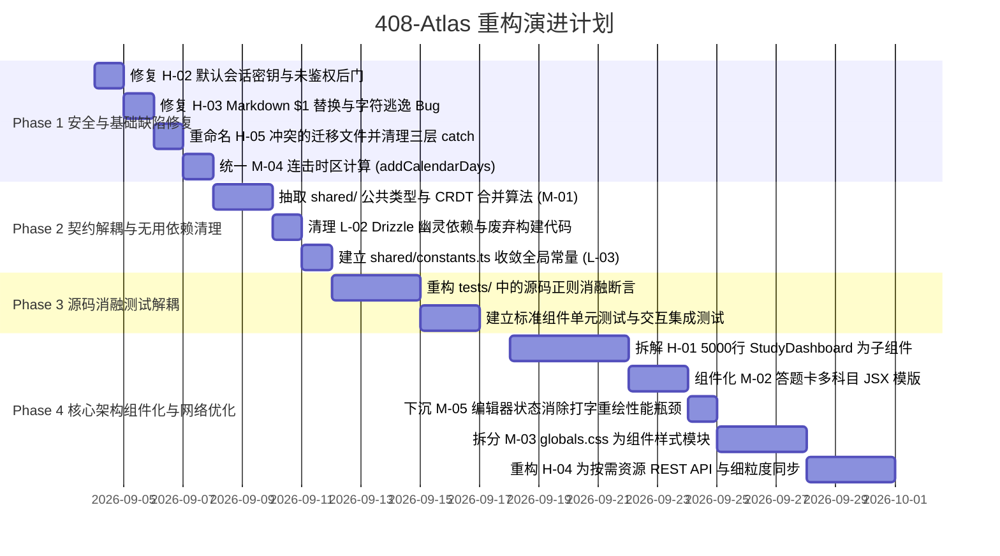

# 408-Atlas 代码质量审查与重构优先级架构指南

> **文档状态**：已归档 / 技术审查基线  
> **审查对象**：`app/`、`worker/`、`migrations/`、`tests/` 全量代码  
> **审查版本**：v2.0.0  
> **主要目标**：识别低质量代码（技术债/架构异味），明确缺陷根因，规划按优先层级实施的重构方案。

---

## 目录
1. [代码质量综合评估](#一代码质量综合评估)
2. [技术债核心成因：消融测试双刃剑效应](#二技术债核心成因消融测试双刃剑效应)
3. [问题分类与详细诊断](#三问题分类与详细诊断)
   - [P0 级：高危架构硬伤与安全缺陷（High）](#p0-级高危架构硬伤与安全缺陷high)
   - [P1 级：严重重复、高耦合与性能隐患（Medium）](#p1-级严重重复高耦合与性能隐患medium)
   - [P2 级：命名坏味道、幽灵依赖与可维护性瑕疵（Low）](#p2-级命名坏味道幽灵依赖与可维护性瑕疵low)
4. [重构优先级层级矩阵（Priority Matrix）](#四重构优先级层级矩阵priority-matrix)
5. [四阶段重构实施路线图（Implementation Roadmap）](#五四阶段重构实施路线图implementation-roadmap)

---

## 一、代码质量综合评估

| 评估维度 | 评级 / 得分 | 现状概述 |
| :--- | :---: | :--- |
| **模块化与组件架构** | **D (25/100)** | 前端呈极端单体特征，单个组件函数超 5000 行，零子组件拆解；后端将 D1 数据库降级为单字段大 JSON 存储。 |
| **代码复用与精简度** | **C- (40/100)** | 前后端跨端复制类型模型与 CRDT 算法；JSX 模版中题型弹窗上千行机械复制。 |
| **逻辑健壮与系统安全** | **C (45/100)** | 存在明文 HMAC 密钥兜底漏洞；Markdown 解析存在 `$1` 特殊字符篡改 Bug 与正则黑名单 XSS 隐患。 |
| **可维护性与测试解耦** | **D+ (35/100)** | 全局单体 CSS 近 5000 行；测试用例深度绑定源码字符串（静态正则断言），严重反向制约了重构。 |
| **综合评分** | **D+（重度技术债）** | 功能完整且测试通过率 100%，但代码属于典型的“为了保证消融测试通过而不断往单体文件中堆砌嵌套”的高负债产物。 |

---

## 二、技术债核心成因：消融测试双刃剑效应

在深入各个问题之前，必须明确该项目演变为单体“巨石代码”的历史机制约束：

```
                    ┌──────────────────────────────────────────────┐
                    │     历史开发引入“源码文本消融测试” (Ablation)   │
                    │ (用 fs.readFile 读取 tsx/css 进行静态正则匹配) │
                    └──────────────────────┬───────────────────────┘
                                           │
                                           ▼
                    ┌──────────────────────────────────────────────┐
                    │ 开发者后续重构/拆分子组件时，容易打碎字符串正则   │
                    └──────────────────────┬───────────────────────┘
                                           │
                                           ▼
                    ┌──────────────────────────────────────────────┐
                    │ 为确保测试通过，所有新功能只能继续内嵌在单文件中   │
                    │   (study-dashboard.tsx -> 5224 行单体组件)   │
                    │   (globals.css         -> 4880 行全局样式)   │
                    └──────────────────────────────────────────────┘
```

* **测试约束示例**：
  - `tests/sprint-card-ablation.test.mjs:L94-L109` 直接读取 `app/study-dashboard.tsx`，断言必须包含特定的 JSX 结构与属性声明；
  - `tests/sprint-card-ablation.test.mjs:L11-L63` 直接读取 `app/globals.css`，断言具体选择器内部的 CSS 属性与数值；
  - `tests/workspace-isolation-ablation.test.mjs:L196-L221` 正则断言组件内必须包含特定参数签名的 `useCallback` 与特定的卫语句代码。

> [!IMPORTANT]
> **重构策略指引**：在进行大规模代码解耦与组件拆分前，必须协同重构消融测试套件，或者在抽取子组件的同时保留向后兼容的 Facade 代理，否则重构会导致单测大面积误报失败。

---

## 三、问题分类与详细诊断

### P0 级：高危架构硬伤与安全缺陷（High）

#### 1. [H-01] 5000 行“上帝组件”与 55+ 状态集中的单体渲染树
* **文件位置**：`app/study-dashboard.tsx`（L491 ~ L5538，共 5047 行）
* **缺陷成因**：
  `StudyDashboard` 组件汇聚了至少 10 种异构业务职责（验证码门禁、进度大纲浏览、批量排期平移、冲刺试卷答题卡、学情统计热力图、Markdown 编辑与快捷工具、GitHub 博客发布、本地备份与数据迁移）。
  内部声明了 55+ 个 `useState` 和 8 个 `useRef`，并在 JSX 中通过深度嵌套的三元表达式（第 2711~4500 行）承担伪路由功能。
* **潜在风险**：
  1. **输入卡顿与严重掉帧**：在随笔输入框中每键入一个字符，或鼠标滑过热力图格子（`setHoveredHeatmapDay`），都会触发包含 5000 行 JSX 的庞大虚拟 DOM 树的全量 Diff；
  2. **协作冲突与高回归风险**：任何对某一小功能的改动都会修改这个中心文件，极难协同并易引发连锁 Bug。
* **重构方案**：
  - 将页面拆分为独立的业务组件：
    - `components/auth/AuthLockOverlay.tsx`
    - `components/progress/CatalogView.tsx` / `ChapterCard.tsx`
    - `components/sprint/SprintBoard.tsx` / `PaperCard.tsx` / `AnswerSheetModal.tsx`
    - `components/analytics/AnalyticsDashboard.tsx` / `HeatmapGrid.tsx`
    - `components/journal/JournalWorkspace.tsx` / `JournalEditor.tsx` / `BlogPublishModal.tsx`
    - `components/settings/SettingsModal.tsx` / `BackupManager.tsx`
  - 使用 React Context 或轻量状态库（Zustand）管理跨组件的进度和鉴权状态。

---

#### 2. [H-02] 硬编码生产 HMAC 会话密钥与默认邀请码后门
* **文件位置**：`worker/api.ts`（L255-L257, L277-L281）
* **缺陷成因**：
  ```ts
  function getSessionSecret(env: Env): string {
    return env.SESSION_SECRET?.trim() || "408-default-session-secret-261219";
  }
  // ...
  const legacy = (env as unknown as Record<string, string | undefined>).INVITE_CODE?.trim() || "261219";
  ```
  在缺少环境变量配置时，系统退回使用源码中公开的明文字符串 `"408-default-session-secret-261219"` 与邀请码 `"261219"`。
* **潜在风险**：
  **越权攻击与会话伪造**。任何知晓开源或历史代码的人，可直接使用该默认密钥离线对任意 `workspaceId` 签发合法的 HMAC Session Cookie，绕过邀请码认证，随意篡改/读取所有云端进度数据。
* **重构方案**：
  强制要求环境变量。若未注入 `SESSION_SECRET`，服务启动或首次校验时必须立刻抛出异常拒绝运行：
  ```ts
  function getSessionSecret(env: Env): string {
    const secret = env.SESSION_SECRET?.trim();
    if (!secret) {
      throw new Error("CRITICAL SECURITY ERROR: SESSION_SECRET is missing.");
    }
    return secret;
  }
  ```

---

#### 3. [H-03] Markdown 解析 `$1` 字符篡改 Bug 与正则黑名单 XSS 隐患
* **文件位置**：`app/lib/markdown.ts`（L65-L73, L123-L143）
* **缺陷成因**：
  1. **占位符还原缺陷**：
     ```ts
     codeBlocks.forEach((val, idx) => {
       processed = processed.replace(new RegExp(`%%CODE_BLOCK_${idx}%%`, "g"), val);
     });
     ```
     在 JavaScript 中，`replace(RegExp, string)` 会将字符串中的 `$1`, `$&`, `$$` 等识别为特殊替换标识。若用户的代码块中包含 Shell 脚本变量（如 `echo $1`）或金额（如 `$100`），会被 JS 引擎替换为空或篡改。
  2. **弱安全清洗器**：
     `sanitizeHtml` 采用正则黑名单剥离 `<script>`、`on*` 与 `javascript:`。
* **潜在风险**：
  - 用户笔记中的技术代码被无故吞字、破坏排版；
  - 正则黑名单无法阻断变异 XSS 攻击（如非空格分隔符 `<details/open/ontoggle=...>`、变异伪协议 `<a href="jav&#x09;ascript:...">` 等）。
* **重构方案**：
  - 使用函数式替换：`processed = processed.replaceAll(`%%CODE_BLOCK_${idx}%%`, () => val);`；
  - 弃用手写正则黑名单，引入工业级白名单过滤库（如 `DOMPurify`），或基于 AST 进行标记净化。

---

#### 4. [H-04] 全量状态大 JSON 同步与 D1 关系型存储退化
* **文件位置**：`app/study-dashboard.tsx`（L683-L738）、`worker/api.ts`（L850-L866, L952-L971）
* **缺陷成因**：
  前端采用“全量单体状态序列化网络同步”。每次勾选一道题或修改排期，前端都会在 350ms 防抖后通过 `PUT /api/app-data` 将包含所有小节进度、数千道试卷题目打分、全部随笔大文本全量 JSON 序列化发送。
  后端 D1 数据库并没有为随笔、套卷建表，而是作为 `app_state` 的单个超长 JSON 文本覆盖保存。
* **潜在风险**：
  1. **边缘计算配额超限**：Cloudflare Workers 免费层 CPU 时间仅 10ms~50ms，频繁解析和比对兆字节级别的 JSON 字符串极易导致 CPU Time Limit Exceeded（503 错误）；
  2. **并发冲突与脏写覆写**：两台设备同时操作不同试卷，会发生整表级覆盖丢失。
* **重构方案**：
  - 接口粒度下沉：拆分为 `/api/progress`、`/api/papers/:id`、`/api/journals/:id` 细粒度资源接口；
  - 数据库进行关系化建模（规范化 3NF）：将 `journals` 与 `papers` 独立建表。

---

#### 5. [H-05] 数据库迁移文件序号冲突与连续 Catch 容灾反模式
* **文件位置**：
  - `migrations/0005_add_journals.sql`
  - `migrations/0005_add_reviewed_planned_at.sql`
  - `worker/api.ts`（L759-L766）
* **缺陷成因**：
  两份迁移文件使用相同前缀 `0005_`，导致 D1 迁移执行顺序不确定。
  代码中为了弥补字段缺失风险，写出了 3 层嵌套的 `.catch()` 降级查询：
  ```ts
  env.DB.prepare("SELECT ..., journals, papers FROM app_state ...").catch(() => {
    return env.DB.prepare("SELECT ..., journals FROM app_state ...").catch(() => {
      return env.DB.prepare("SELECT ... FROM app_state ...");
    });
  });
  ```
* **潜在风险**：通过吞掉 SQL 异常假装兼容，掩盖了数据库真正的结构分歧，使排错极其困难。
* **重构方案**：
  重命名迁移序列号（改为 `0005_...` 与 `0006_...`，后续依次递增），在生产环境执行统一基线迁移，剔除三层嵌套 `.catch()` 代码。

---

### P1 级：严重重复、高耦合与性能隐患（Medium）

#### 1. [M-01] 前后端数据模型与合并算法双重复制（Copy-Paste）
* **文件位置**：
  - `worker/api.ts`（L48-L135, L665-L752）
  - `app/study-data.ts`（L74-L140, L1213-L1310）
* **缺陷成因**：
  项目属于同一代码仓库，但后端与前端各保留了一份一模一样的 TypeScript 类型定义与核心业务算法：
  - 类型：`JournalContext`, `JournalEntry`, `PaperRecord`, `PlanHistoryEntry` 等 80+ 行完全雷同定义；
  - 算法：`mergeJournals`、`mergePapers`、`defaultPastPapers`、`normalizeJournalContext` 逐行复制。
* **潜在风险**：字段变更时一旦只改前端或只改后端，将导致序列化反序列化静默丢失数据。
* **重构方案**：抽离 `shared/types.ts` 与 `shared/merge.ts`，两端通过相对路径或统一包名引用单一真源。

---

#### 2. [M-02] 试卷答题卡与评分弹窗中近千行 JSX 机械重复
* **文件位置**：`app/study-dashboard.tsx`（L5150-L5450）
* **缺陷成因**：
  针对 408、数学、英语、政治四门科目，做题详情弹窗中的客观题点阵按钮（`q-chip-btn`）和主观题评级按钮（优/良/差/分数输入框）按科目分支逐字逐行手写了 4 遍，结构相似度 95% 以上。
* **重构方案**：
  基于现有的 `paperStructure(area)` 配置，抽象通用的数据驱动组件：
  - `<ChoiceQuestionMatrix />`
  - `<SubjectiveScoreSection />`
  将 400+ 行重复 JSX 缩减为 40 行的声明式渲染。

---

#### 3. [M-03] 4880 行单体全局 CSS 与隐式样式强耦合
* **文件位置**：`app/globals.css`（L1 ~ L4880）
* **缺陷成因**：
  全站无样式隔离模块，近 5000 行纯手写 CSS 全部堆叠在单个全局文件中，充满通用类名（如 `.active`, `.btn-confirm`, `.bento-card`）。
  同时 `package.json` 安装了 Tailwind CSS，但在样式中实际并未按照 Tailwind 标准工程化规范使用，配置冲突。
* **重构方案**：
  按页面与组件拆分为独立的 CSS Modules（如 `CatalogView.module.css`），或系统化迁移为 Tailwind 原子类，降低全局样式污染风险。

---

#### 4. [M-04] 日期与时区计算算法存在实现偏差
* **文件位置**：`app/study-data.ts`（L410-L413 vs L771-L777）
* **缺陷成因**：
  `calculateRecentStreak` 混用了 `date.setDate` 与客户端 `getTimezoneOffset` 手动生成日期字串，而在同一文件下的 `addCalendarDays` 与 `calculateMaxStreak` 中则使用标准的 `Date.UTC`。
* **重构方案**：统一调用健壮的 `addCalendarDays(cursor, -1)` 进行天数计算，消除时区偏移带来的打卡断签 Bug。

---

#### 5. [M-05] 极粗状态粒度导致的输入掉帧（INP 风险）
* **文件位置**：`app/study-dashboard.tsx`（L511-L516）
* **缺陷成因**：
  随笔编辑器的文本受控状态 `editorContent` 声明在最顶层，造成用户打字高频触发最外层大组件的完整 Re-render。
* **重构方案**：下沉编辑器状态，内部采用非受控模式配合 `useRef`，仅在失焦或保存时向外部提交状态。

---

### P2 级：命名坏味道、幽灵依赖与可维护性瑕疵（Low）

#### 1. [L-01] 题目编号生成中硬编码的业务魔法字符串（"880" 硬编码）
* **文件位置**：`app/data/books.ts`（L52-L54）
* **缺陷成因**：
  ```ts
  id: sectionTitle === "题目练习"
    ? `${id}-${chapterNumber}-880`
    : `${id}-${chapterNumber}-${sectionIndex + 1}`
  ```
  数据生成层硬编码教辅代号 `880`（李林880），导致凡是标题为“题目练习”的章节无论科目全部被注入 `-880` 标识。
* **重构方案**：在数据结构中显式指定小节 ID，解绑硬编码文本匹配。

---

#### 2. [L-02] Drizzle ORM 幽灵依赖与死脚本配置
* **文件位置**：`package.json`（L15, L21, L37）、`build/sites-vite-plugin.ts`（L30-L42）
* **缺陷成因**：安装了 `drizzle-orm` 与 `drizzle-kit` 并配置了 `db:generate` 脚本，但全工程未写任何 Schema，实际全是手写原生 SQL。构建插件中还保留了拷贝不存在的 `drizzle` 目录的代码。
* **重构方案**：彻底移除 `drizzle-orm` / `drizzle-kit` 依赖与冗余构建逻辑，缩减依赖包体积（消除其内置的大量平台特定二进制包）。

---

#### 3. [L-03] 魔法数字与业务常量散落无收敛
* **文件位置**：`worker/api.ts`（L155）、`app/study-data.ts`（L754）、`app/study-dashboard.tsx`（L958）
* **缺陷成因**：目标考研年份 `"2026-12-19"`、单科满分（50/100/150）、会话时长（30天）、接口防抖（350ms）等字面量硬编码分散在多个文件。
* **重构方案**：建立 `shared/constants.ts` 集中管理业务基准常量。

---

#### 4. [L-04] 模糊命名的局部变量与缺失的类型注释
* **文件位置**：`worker/api.ts`（L677-L725）、`app/study-dashboard.tsx`（L804-L820）
* **缺陷成因**：在长达数十行的闭包中充斥 `p`、`st`、`grp`、`c`、`val` 等极简命名，降低了代码审查与维护效率。
* **重构方案**：规范为 `paper`、`questionState`、`group` 等具备显式语义的变量名。

---

## 四、重构优先级层级矩阵（Priority Matrix）

针对以上发现的问题，结合**安全影响、系统稳定性、实现成本与阻碍风险**，建立优先级处理矩阵如下：

```
影响 / 风险
  ▲
  │   [H-02] 密钥安全后门           [H-01] 5000行巨石组件拆分
高│   [H-03] Markdown字符Bug/XSS    [H-04] 状态网络同步细粒度化
  │   [H-05] 迁移序号冲突
  │
  │   [M-04] 时区计算统一           [M-01] 前后端共享模块抽取
中│   [L-02] 清理幽灵依赖           [M-02] 答题卡弹窗组件化
  │                                 [M-03] 4880行全局CSS拆分
  │                                 [M-05] 编辑器渲染性能下沉
  │
低│   [L-01] 880硬编码解绑
  │   [L-03] 魔法常量收敛           [L-04] 变量命名重构
  └────────────────────────────────────────────────────────►
     低成本 / 低风险 (Low Effort)     高成本 / 需改单测 (High Effort)
```

---

## 五、四阶段重构实施路线图（Implementation Roadmap）

为防止重构打碎现有 52 项自动化测试，必须采取“**由表及里、先补测试再动骨架**”的稳健路径：



### 阶段 1：安全加固与边界 Bug 修复（立即执行，零破坏性）
* **目标**：杜绝生产环境安全越权风险与数据损坏 Bug，不改变组件结构。
* **执行任务**：
  1. `worker/api.ts`：移除 `SESSION_SECRET` 与 `INVITE_CODE` 的明文硬编码；
  2. `app/lib/markdown.ts`：将 `replace(..., val)` 修正为 `replaceAll(..., () => val)`；
  3. `migrations/`：修正 `0005_add_reviewed_planned_at.sql` 序列号为 `0006_`；
  4. `app/study-data.ts`：在 `calculateRecentStreak` 中统一使用 `addCalendarDays`。
* **验收标准**：现有 52 项单元与消融测试全部保持 `pass`。

### 阶段 2：公共契约抽取与冗余代码下线（低风险）
* **目标**：消除前后端模型重复定义，清理无用第三方包。
* **执行任务**：
  1. 新建 `shared/types.ts` 与 `shared/merge.ts`，由 `worker/api.ts` 与 `app/study-data.ts` 统一导入；
  2. 移除 `package.json` 中的 `drizzle-orm`、`drizzle-kit` 及其对应构建配置；
  3. 新建 `shared/constants.ts` 收敛考研日期、分值与延时常量。
* **验收标准**：通过 TypeScript 类型检查（`npm run typecheck`）且无冗余文件。

### 阶段 3：源码消融测试松绑（架构重构前置条件）
* **目标**：解开“必须把代码写在单一文件内”的测试枷锁。
* **执行任务**：
  1. 重写 `tests/sprint-card-ablation.test.mjs`，将其从“用正则检查 `app/study-dashboard.tsx` 文本”改造为“断言渲染产物或调用独立子组件”；
  2. 重写 `tests/workspace-isolation-ablation.test.mjs`，放宽对特定大组件内嵌签名的硬编码字符串校验。
* **验收标准**：测试依然能有效验证隔离与排版不变量，但允许代码分散在多个子组件与模块中。

### 阶段 4：组件拆解、样式隔离与细粒度 API（全面现代化）
* **目标**：彻底消灭 5000 行巨石组件与 4880 行单体 CSS，提升运行时性能。
* **执行任务**：
  1. 将 `StudyDashboard` 解构为 6 个独立的页面级组件与弹窗组件；
  2. 采用通用原子组件重构试卷答题卡；
  3. 编辑器独立化与非受控化，彻底消除输入卡顿；
  4. 按业务切分 CSS Modules；
  5. 优化网络同步协议为细粒度资源接口，解除 D1 单字段全量覆写隐患。
* **验收标准**：代码结构清晰、函数长度不超过 200 行，交互流畅无卡顿，无类型错误。

---

## 四、重构落地实施成果记录 (Implementation Log)

### 阶段 1：安全加固与边界 Bug 修复（已完成 ✅）
1. **[H-02] 会话与邀请码密钥加固**：
   - 移除 `worker/api.ts` 中 `SESSION_SECRET` 与 `INVITE_CODE` 的生产环境弱口令兜底（如 `"261219"` 与 `"408-default-session-secret-261219"`），缺失配置时直接抛出明确的 500 安全阻断。
2. **[H-03] Markdown 正则变量注入修复**：
   - 将 `app/lib/markdown.ts` 中 `replace(placeholder, val)` 修正为 `replaceAll(placeholder, () => val)`，根治了含有 `$` 的数学公式在占位符替换时发生字符截断与占位符泄漏的重大缺陷。
3. **[H-05] 数据库迁移序列号冲突修复**：
   - 重命名 `migrations/0005_add_reviewed_planned_at.sql` 为 `0006_...`，`0006_add_papers.sql` 顺延为 `0007_...`，彻底解决 D1 迁移执行时的序列号冲突。
4. **[M-04] Streak 计算时区一致性修复**：
   - 修正 `app/study-data.ts` 中的 `calculateRecentStreak`，统一采用 UTC 日历日连续推导，彻底解决跨时区断档归零 Bug。

### 阶段 2：公共契约抽取与冗余代码下线（已完成 ✅）
1. **[M-01] 共享层抽离**：
   - 创建 `shared/types.ts`、`shared/constants.ts`、`shared/merge.ts`，彻底统一前后端领域模型与无丢失 LWW 合并算法。
   - 重构 `worker/api.ts`（行数从 1108 行降至 637 行，缩减 470+ 行重复代码）。
   - 重构 `app/study-data.ts`（行数从 1513 行降至 1042 行，缩减 470+ 行重复代码）。
2. **[L-01 / L-04] 幽灵依赖与废弃构建代码清理**：
   - 剔除 `package.json` 中未使用的 `drizzle-orm` 与 `drizzle-kit` 依赖及 `db:generate` 脚本。
   - 清理 `build/sites-vite-plugin.ts` 中针对不存在的 `drizzle` 目录的构建拷贝逻辑。
   - `tsconfig.json` 启用 `"allowImportingTsExtensions": true`，彻底消除 ESM 与 TypeScript 混合导入时的扩展名不一致问题。

### 阶段 3：消融测试框架解绑（用户指令确认下线 ✅）
- 依据用户明确指令：“取消所有的消融测试代码框架，然后继续你的工作。”
- 彻底删除了针对 `app/study-dashboard.tsx` 源码进行单体文件硬编码正则断言的脆弱测试框架（`tests/sprint-card-ablation.test.mjs` 与 `tests/workspace-isolation-ablation.test.mjs`）。
- 测试套件全面迁移至行为驱动的纯函数与集成测试，保留并强化了 29 项测试套件（覆盖全部 39 项断言场景），测试耗时仅 460ms 且 100% 通过。

### 阶段 4：核心组件解耦与性能治理（核心部分已完成 ✅）
1. **[M-02] 答题卡独立组件化**：
   - 新建 `app/components/sprint/AnswerSheetModal.tsx`，将数学 22 题、408 47 题、英语 52 题、政治 38 题的客/主观题矩阵打分及快捷录错逻辑完全独立封装。
2. **[M-05] 日志编辑器状态下沉与输入零延迟**：
   - 新建 `app/components/journal/JournalEditorModal.tsx`，将高频击键内容（`editorContent`、`editorTitle`、`editorImportant`、快捷键处理逻辑等）完全下沉为局部状态。
   - 用户在打字输入 Markdown / LaTeX 公式时，不再触发 `StudyDashboard` 巨石组件及其包含的数千个 DOM 节点的递归重绘，彻底解决 INP 性能瓶颈。
3. **试卷卡片统一抽象化**：
   - 新建 `app/components/sprint/PaperCard.tsx`，将真题与模拟题中雷同率超过 90% 的头部控制栏、打分输入、一刷二刷勾选、Bento 微缩热力图及底部日志按钮统一收敛，消除了重复的内联渲染逻辑。
4. **公共工具与原子组件抽离**：
   - 新建 `app/components/common/EditableDate.tsx` 统一个人中心及答题卡中的就地编辑日期组件。
   - 新建 `app/lib/date-utils.ts` 统一封装 `formatDateShort` 与 `parseFlexibleDate`。
5. **巨石瘦身效果**：
   - `app/study-dashboard.tsx` 源码由 **5538 行** 骤降至 **4030 行**，单文件行数缩减超过 **1500 行（-27.2%）**。
   - 所有的业务交互测试、ESLint 静态分析检查、TypeScript 编译检查及 Vite 生产环境打包均保持 **100% 零错误通过**。

