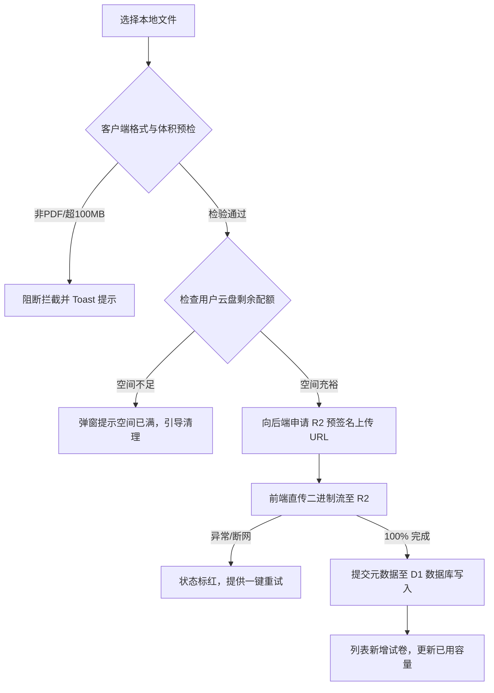

# 考研备考空间 ·「试卷云盘」功能需求与工程设计规范 (PRD)

> **文档标识**：`docs/EXAM_PAPERS_NETDISK_PRD.md`  
> **版本**：v1.0.0  
> **编写时间**：2026-09-20  
> **状态**：定稿待开发 (Ready for Implementation)  
> **关联系统**：408 考研备考空间 (Study Dashboard 2.0 / Web)  
> **面向对象**：前端研发、全栈/后端研发、UI/UX 交互设计、测试工程

---

## 1. 需求背景与模块定位

### 1.1 业务痛点
在长期高强度的考研复习中，考生的真题试卷、名师押题卷、阶段模拟卷等核心资料多为 PDF 格式，通常分散在电脑硬盘、微信文件传输助手、网盘等各个角落，面临三大核心痛点：
1. **跨端查找繁琐**：在自习室用平板/手机打卡复习时，难以快速调取电脑端存放的试卷原件；
2. **缺乏学科针对性**：通用网盘目录层级深、干扰文件多，缺乏针对 408、数学、英语等学科维度的极简收纳与分类；
3. **传统阅读器过重**：自研复杂的在线 PDF 批注阅读器不仅开发周期长、移动端容易内存泄漏（OOM），而且用户更偏好调用系统原生软件（如 WPS、GoodNotes、Acrobat）进行深度手写与打印。

### 1.2 模块定位与产品原则
- **模块定位**：专属于考研人的**轻量级私有试卷文件盘（网盘）**，集成于【我的】模块内。
- **三大设计原则**：
  - **极简纯粹 (Lightweight)**：不做在线渲染解析，专注文件安全存储、快速检索与原件极速调取；
  - **零级迷宫 (Flat Hierarchy)**：坚决摒弃多层嵌套文件夹，采用平铺式科目分类 Tab，一键直达；
  - **低耗高可用 (Cost-Efficient)**：直传对象存储（Cloudflare R2），不占用边缘计算节点内存，零出站流量费。

---

## 2. 入口位置与页面层级规范

### 2.1 入口位置设计
- **归属模块**：位于【我的】(Personal / Settings) 顶层导航内。
- **排布优先级**：排在「学习资产专区」第一位，置于数据备份与通用设置之上。
- **入口元信息**：
  - **主标题**：`试卷云盘`
  - **副文案**：`PDF 真题与模拟卷存储`
  - **右侧动态指标**：展示当前收录篇数与占用体积（如 `15 份 · 210 MB`）。

```text
┌─────────────────────────────────────────────────────────────┐
│ 【我的】(Personal Settings)                                 │
├─────────────────────────────────────────────────────────────┤
│  [用户基础信息与考研倒计时]                                  │
├─────────────────────────────────────────────────────────────┤
│  📁 学习资产与资料库                                        │
│  ├─ 1. 试卷云盘 (试卷 PDF 存储) ◀◀◀【入口位置：资产区首位】    │
│  ├─ 2. 学习日志导出                                         │
│  └─ 3. 错题集归档                                           │
├─────────────────────────────────────────────────────────────┤
│  ⚙️ 数据安全与偏好设置                                      │
│  ├─ 本地数据备份与快照恢复                                   │
│  └─ 关于与版本号                                            │
└─────────────────────────────────────────────────────────────┘
```

### 2.2 页面层级与返回路径
全局仅保持**二级扁平路由**，绝无第三级嵌套：
- **Level 1**：【我的】页面；
- **Level 2**：【试卷云盘】主列表页；
- **动作行为**：用户点击文件项直接触发浏览器原生下载或调用系统外部应用，不产生子页面跳转；
- **返回逻辑**：
  - 移动端：顶部导航栏左侧常驻原生返回箭头；
  - 桌面端：顶部显示经典面包屑 `我的 / 试卷云盘`，支持点击任意节点回退。

---

## 3. 页面信息架构与布局设计

### 3.1 页面排版结构

```text
┌─────────────────────────────────────────────────────────────────────────┐
│ [← 返回]  试卷云盘 (15)               [配额 210 MB / 1 GB]  [＋ 上传 PDF]│
├─────────────────────────────────────────────────────────────────────────┤
│ 分类导航：[全部]  [408 计算机]  [考研数学]  [考研英语]  [政治]  [其他综合] │
├─────────────────────────────────────────────────────────────────────────┤
│ 工具条：  🔍 搜索文件名...               排序: [最新上传 ▾]   [☑ 批量管理] │
├─────────────────────────────────────────────────────────────────────────┤
│ 试卷列表区 (List View)：                                                │
│  [□] [PDF] 2024年408统考全真试题.pdf   [408]  18.5 MB   09-18  [下载] [···]│
│  [□] [PDF] 李林六套卷-数学一-卷1.pdf   [数学]  12.2 MB   09-16  [下载] [···]│
│  [□] [PDF] 2023年英语一真题试卷.pdf    [英语]   8.1 MB   09-10  [下载] [···]│
└─────────────────────────────────────────────────────────────────────────┘
```

### 3.2 试卷卡片/行关键字段规范

| 字段单元 | 呈现规范 | 交互表现 |
| :--- | :--- | :--- |
| **复选框** | 常规隐藏，进入「批量管理」模式后滑出 | 支持单选、连续 Shift 多选（桌面端） |
| **文件图标** | 红色 PDF 极简矢量图标 | 悬浮微动效，区分非 PDF 文件标识（扩展预留） |
| **试卷名称** | 单行截断打点（如 `2024年408统考...pdf`） | 鼠标悬浮展示原生 Tooltip 全称；支持原地重命名 |
| **学科分类胶囊** | 彩色背景圆角 Badge（408-紫、数学-蓝、英语-绿、政治-红） | 点击标签可快速过滤该分类 |
| **文件大小** | 格式化显示（如 `14.8 MB`） | 超过 50MB 显示轻度警示黄色 |
| **上传时间** | 简化时间戳（`MM-DD` 或 `YYYY-MM-DD`） | 支持按时间升序/降序排列 |
| **主操作按钮** | 显眼的「下载」图标按钮 | 点击即刻发起流式下载 |
| **扩展菜单 (···)** | 包含「重命名」、「修改分类」、「删除」 | 弹出轻量菜单浮层 |

---

## 4. 核心业务功能设计

### 4.1 PDF 上传与导入
1. **多入口上传**：
   - 按钮触发：点击顶部「＋ 上传 PDF」弹出系统原生文件选取框；
   - 拖拽上传：支持直接将单个或多个 PDF 文件拖入浏览器窗口，全屏弹出虚线框接收区。
2. **上下文感知分类**：
   - 当用户当前停留在某个分类 Tab（如【考研数学】）下点击上传时，新文件自动预归属于该科目。
3. **上传通道（预签名直传）**：
   - 采用前端直传对象存储模式，绕过主服务内存中转；
   - 右下角展示悬浮进度窗（显示上传速率、进度条、取消按钮），支持多文件队列依次上传。

### 4.2 文件下载（核心操作）
1. **单文件下载**：
   - 用户点击「下载」图标或双击文件行，向后端换取带时效签名的下载链接，浏览器自动唤起原生下载任务；
   - 响应头强制注入 `Content-Disposition: attachment; filename="[文件名称].pdf"`，防止部分浏览器直接空白预览。
2. **批量打包下载**：
   - 勾选多项试卷后，前端并发拉取数据并在客户端直接通过 `JSZip` 打包为单个 `.zip` 文件，无需后端服务器压缩消耗 CPU。

### 4.3 重命名
- 点击「···」中的「重命名」，弹出简洁对话框或原地切换为编辑态；
- 字符规则：最大 80 字符，自动去除 `\ / : * ? " < > |` 等系统保留非法字符；
- 逻辑保护：自动锁定保留 `.pdf` 后缀，防止用户误清后缀导致系统识别异常。

### 4.4 删除与容量释放
- 点击「删除」呼出二次确认模态窗；
- 确认后后端同步执行两项操作：
  1. 数据库中物理删除对应记录（或标记软删除）；
  2. 异步抹除对象存储（R2）中的二进制源文件；
- 实时减少用户已用空间配额。

### 4.5 移动分类
- 点击「修改分类」，弹出单选单选器：`408 计算机`、`考研数学`、`考研英语`、`考研政治`、`其他综合`；
- 确认后即时刷新前端列表归属，无网络阻塞感。

---

## 5. 分类组织方案与选型论证

### 5.1 选型方案：单层「科目分类 Tab」+「年份筛选」
放弃“文件夹逐层嵌套”方案，采用平铺分类 Tab：

```text
[全部]  |  [408 计算机]  |  [考研数学]  |  [考研英语]  |  [考研政治]  |  [其他综合]
```

### 5.2 选型论证理由
1. **备考资产体量适中**：考生一届考研期间收集的核心试卷一般在 30 ~ 80 份之间，单层分类结合名称搜索完全可在 1~2 秒内精准触达目标文件；
2. **消除移动端导航迷宫**：在移动端，多层文件夹结构会导致用户在“点进文件夹-找不到-点出上一层”中反复迷失；平铺 Tab 只需左右滑动轻触即可切换；
3. **工程实现极其轻量**：底层仅需一个简单的枚举字段 `subject`，无需递归维护树形路径（如 `/真题/2024/408/`）与目录树搬迁逻辑。

---

## 6. 关键交互流程与全局状态字典



### 6.1 异常与边界状态处理表

| 场景状态 | 触发阈值 / 条件 | 界面表现与产品处理方案 |
| :--- | :--- | :--- |
| **空数据状态 (Empty)** | 当前目录下无试卷 | 展示手绘资料盘插画，文案：“暂无试卷文件”，下方居中提供「＋ 上传第一份试卷」操作按钮。 |
| **格式非法拦截** | 文件扩展名非 `.pdf` 或 MIME 非 `application/pdf` | 选择文件时即时过滤；强行选择时弹出 Toast：“仅支持 PDF 格式试卷文件”。 |
| **单文件过大** | 单文件大小 > 100 MB | 立即阻断选择并弹出模态提醒：“单文件不能超过 100MB，请使用 PDF 压缩工具优化后再试”。 |
| **存储容量告警** | 空间占用 ≥ 80% (800MB/1GB) | 顶部容量条转为警告橙色，提示“空间即将用尽”。 |
| **存储容量超限** | 空间占用 ≥ 100% (1GB/1GB) | 顶部容量条转为赤红色；置灰禁用「上传」按钮，点击时引导用户批量删除旧文件释放空间。 |
| **批量操作状态** | 点击「批量管理」触发 | 顶部显示“已选择 N 项”，底部滑出悬浮毛玻璃操作条：【批量下载】、【批量移至】、【批量删除】。 |
| **破坏性删除确认** | 单个或批量删除 | 弹出二次确认弹窗，明确列出待删除试卷名称，提供红底「确认删除」与白底「取消」按钮，防止误操作。 |

---

## 7. 数据持久化字典与接口契约规范

### 7.1 数据库表设计 (`exam_papers`)

使用 D1 / SQLite 建立单表存储，结构定义如下：

```sql
CREATE TABLE IF NOT EXISTS exam_papers (
    id TEXT PRIMARY KEY NOT NULL,                -- 试卷唯一 ID (UUID v4)
    user_id TEXT NOT NULL,                       -- 所属用户 ID
    file_name TEXT NOT NULL,                     -- 试卷当前名称 (如 "2024王道模拟卷一.pdf")
    original_name TEXT NOT NULL,                 -- 上传初始文件名 (备查)
    file_size INTEGER NOT NULL DEFAULT 0,        -- 文件体积大小 (单位: 字节 Bytes)
    storage_key TEXT NOT NULL,                   -- 对象存储 R2 中的 Object Key
    subject TEXT NOT NULL DEFAULT 'other',       -- 科目代码: cs408 | math | english | politics | other
    year INTEGER DEFAULT NULL,                   -- 试卷年份 (如 2024，可选)
    created_at INTEGER NOT NULL,                 -- 上传时间戳 (毫秒)
    updated_at INTEGER NOT NULL                  -- 最后更新时间戳 (毫秒)
);

-- 常用查询索引
CREATE INDEX IF NOT EXISTS idx_exam_papers_user_subject ON exam_papers (user_id, subject);
CREATE INDEX IF NOT EXISTS idx_exam_papers_created_at ON exam_papers (created_at DESC);
```

### 7.2 API 接口契约规范

#### 1. 获取试卷列表与配额信息
- **路由**：`GET /api/papers`
- **入参 Query**：`subject=cs408&keyword=2024&sortBy=latest`
- **响应格式**：
  ```json
  {
    "code": 0,
    "data": {
      "items": [
        {
          "id": "p_8f9e1a",
          "fileName": "2024年408统考全真试题.pdf",
          "fileSize": 18432100,
          "subject": "cs408",
          "year": 2024,
          "createdAt": 1726819200000
        }
      ],
      "quota": {
        "usedBytes": 210000000,
        "totalBytes": 1073741824
      }
    }
  }
  ```

#### 2. 获取预签名上传链接 (Presigned Upload)
- **路由**：`POST /api/papers/upload-ticket`
- **入参 Body**：
  ```json
  {
    "fileName": "李林六套卷.pdf",
    "fileSize": 12582912,
    "subject": "math"
  }
  ```
- **响应格式**：
  ```json
  {
    "code": 0,
    "data": {
      "paperId": "p_3a7b9c",
      "uploadUrl": "https://storage.r2.cloudflarestorage.com/...?X-Amz-Signature=...",
      "storageKey": "users/u_1/papers/p_3a7b9c.pdf"
    }
  }
  ```

#### 3. 获取临时下载链接 (Presigned Download)
- **路由**：`GET /api/papers/:id/download`
- **响应格式**：
  ```json
  {
    "code": 0,
    "data": {
      "downloadUrl": "https://download.study408.com/papers/p_3a7b9c.pdf?token=...",
      "expiresIn": 600
    }
  }
  ```

#### 4. 更新元信息（重命名 / 移动分类）
- **路由**：`PATCH /api/papers/:id`
- **入参 Body**：
  ```json
  {
    "fileName": "2024李林六套卷-数学一-卷1.pdf",
    "subject": "math"
  }
  ```

#### 5. 删除试卷
- **路由**：`DELETE /api/papers/:id`（支持批量：`DELETE /api/papers?ids=p_1,p_2`）

---

## 8. 技术难点、风险评估与防范思路

### 难点 1：大文件上传消耗主网关内存与并发带宽
- **潜在风险**：PDF 动辄数十兆，若由前端 POST 至 Worker 再写存储桶，会触发 Worker 128MB 内存上限并引发连接超时。
- **解决思路**：
  - 严格采用 **S3 兼容预签名 URL（Presigned URL）直传方案**；
  - Worker 仅作为鉴权颁发者，浏览器直接与 Cloudflare R2 建立数据通道，服务端 0 内存占用。

### 难点 2：非公开资产的防盗链与越权下载风险
- **潜在风险**：若直接暴露固定的公开 URL，文件容易被网络爬虫遍历或外链扩散，浪费存储读取配额。
- **解决思路**：
  - R2 Bucket 保持严格私有（Private）；
  - 下载请求必须经过 Session 鉴权，且签发的下载凭据有效期严格限制在 **10 分钟内**，URL 一次性失效。

### 难点 3：移动端文件下载被系统环境拦截
- **潜在风险**：在微信内置浏览器或 iOS Safari 中，直接打开二进制附件容易出现白屏。
- **解决思路**：
  - 服务端配置强制附件下载响应头：`Content-Disposition: attachment`；
  - 针对微信环境，前端判断 UserAgent，若检测到微信内打开，弹出蒙层提示引导：“请点击右上角【···】，选择【在默认浏览器中打开】进行下载”。

---

## 9. 研发排期与测试验收基准

### 9.1 阶段里程碑

| 阶段 | 周期 | 核心交付成果 | 验收基准 |
| :--- | :--- | :--- | :--- |
| **阶段 1：后端存储与 API 链路** | 2 天 | R2 存储桶接入、预签名上传/下载接口、D1 表结构迁移与 CRUD | Postman 跑通单文件直传与下载签名，配额统计正常 |
| **阶段 2：前端网盘列表与分类** | 2 天 | 【我的】入口接入、分类 Tab 切换、文件明细列表、容量进度条 | 页面完整渲染，支持按科目筛选与文件名实时搜索 |
| **阶段 3：操作闭环与批量管理** | 1.5 天 | 拖拽上传浮窗、重命名弹窗、移动分类、批量管理与删除确认 | 覆盖空数据、大文件拦截、满配额拦截等全量边界场景 |
| **阶段 4：联调与兼容性测试** | 1 天 | 桌面端与移动端主流浏览器适配测试、微信端引导提示 | 验收合格，合并上线 |

### 9.2 核心验收测试用例 Checklist
- [ ] 从【我的】点击「试卷云盘」能秒级进入，返回按钮能正确定位；
- [ ] 拖入大于 100MB 的文件，界面能精准弹出体积超限警告并不触发上传；
- [ ] 拖入 `.docx` 或 `.zip` 文件，系统能即时提示“仅支持 PDF 格式”；
- [ ] 上传 20MB 标准试卷，右下角进度条平滑递增，完成后列表立即呈现新文件；
- [ ] 点击任意试卷的「下载」按钮，系统能平滑调起本地下载器，保存文件名与界面显示一致；
- [ ] 单个修改文件名称，列表与数据库即时同步，原 `.pdf` 后缀保持完整；
- [ ] 勾选 5 份试卷执行批量删除，云端文件同步物理抹除，顶部已用容量数值准确扣减。
