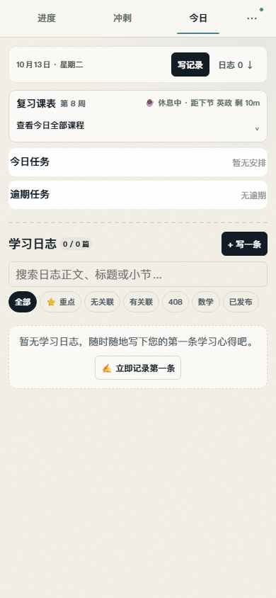
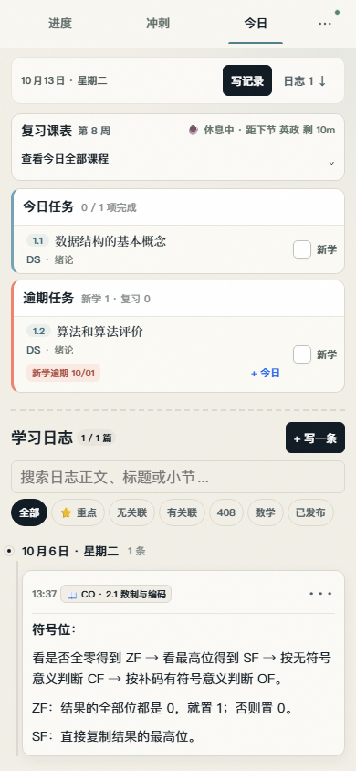
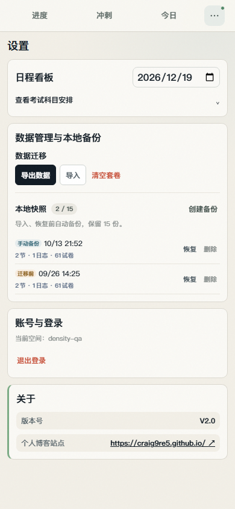

# 手机端信息密度调整

针对今日页、日志列表、设置与本地备份的实机反馈，统一减少大框、重复说明和按钮换行。样式集中于 `app/mobile-density.css`，仅在 ≤600px 生效；日志操作通过 `JournalActions` 在手机折叠、桌面保持工具栏。

| 区域 | 调整 |
| --- | --- |
| 今日页头 | 日期、写记录、日志数量同行；手机不重复显示大标题，页头约 52px。 |
| 课表 | 标题、周次、当前状态尽量同行；课程展开入口变成无边框文字行，取消黄色状态大底色和嵌套按钮框。极窄屏允许状态自然换行。 |
| 今日/逾期任务 | 空状态各用约 40px 的状态行，移除序号、重复数量与空卡片最小高度；有任务时标题和完成操作同排，逾期日期和移到今日操作保留。 |
| 日志列表 | 标题与写入入口同行，移除宣传说明；搜索、筛选取消外层卡片，筛选单行横向滚动。每条日志的时间、关联标签和更多入口同排，重点/编辑/发布/删除收进菜单。正文保持可读字号。 |
| 设置 | 日程标题和日期同行；考试安排入口去掉实体框。导出、导入、清空套卷同行，取消重复说明；清空仍需确认。 |
| 本地备份 | 类型、时间、数据摘要在左，恢复和删除在右；取消大卡片与上下分离布局，备份行不超过 64px，创建备份改为文字入口。自动备份提示与恢复/删除确认保留。 |

## 验证

- 使用模拟 API 和本地备份数据，在 320、390、430、600 和 1280px 分别验证空任务/无日志与有今日任务、逾期任务、日志、两份备份的状态。
- 检查手机页面无横向溢出，页头 ≤58px、空任务行 ≤48px、备份行 ≤64px、日程设置卡 ≤110px，日志更多入口位于元信息同一行。
- 验证手机菜单展开、Esc 收起、编辑器打开/关闭，以及恢复备份确认可打开；桌面日志操作保持直接可见。
- 类型检查、Lint 和 77 项测试通过。截图为 390×844 的浏览器模拟结果，实机键盘和浏览器工具栏仍由真实设备决定。

## 渲染示例

## 发布记录

已通过项目配置部署到 https://study.craig9re5.workers.dev ，版本 58fa4786-9668-440d-b056-214add6d5baa。首页及引用的 CSS/JavaScript 返回 HTTP 200，线上 CSS 与本地构建 SHA-256 一致；线上模拟空间在 320/390/1280px 再次通过布局与交互检查，未修改真实学习数据。
