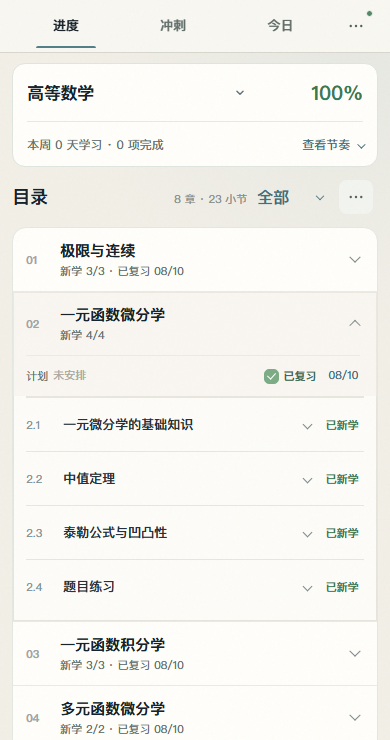
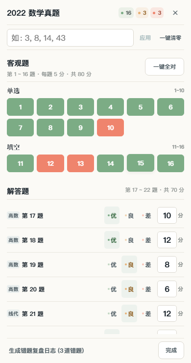
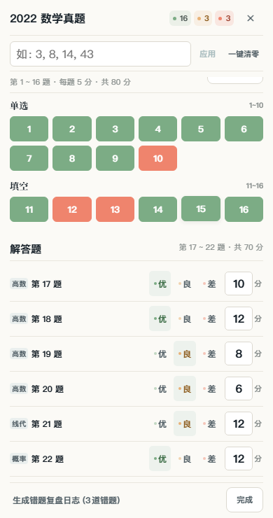

# 移动端目录与答题卡布局修正（第二轮）

## 第三轮：移除非必要信息与入口

按用户圈选，手机端隐藏整个本周节奏区、更多菜单中的复习课表、今日页的全屏/设置按钮、答题卡批量录入/应用/清零工具栏。答题卡网格同步改为标题/正文/底栏三行，避免隐藏工具栏后遗留空白。数据分析通过统一功能开关在所有屏幕关闭入口与页面渲染。桌面课表保留。

此前本地隐藏分析入口的改动未被带入隔离部署，这一遗漏已在第三轮发布中补齐。未部署的其他改动及清理结果见 [本地改动清单](LOCAL_CHANGES_AND_CLEANUP_2026-10-13.md)。下文第二轮截图保留为历史记录。

## 第二轮纠正

用户实机反馈表明第一轮视觉验收不充分：完成状态下的复习区被排成两层，左侧计划跨行导致大块空白；答题卡的固定批量工具区、五列拉伸题号以及两行评级卡片过大。第一轮的功能检查通过不能作为视觉验收通过的依据。本轮使用与反馈一致的完成数据重新渲染并调整。

## 最终方案

| 区域 | 处理 |
| --- | --- |
| 目录筛选 | 保留无边框的紧凑文字下拉，减少“全部”的视觉重量。 |
| 章节复习 | 计划、已复习、完成日期排在同一行；取消日期与状态的大边框背景，计划居左、状态和日期靠右。正常显示高度约 41px，编辑日期时允许自然换行。 |
| 小节详情 | 保留卡片全宽内容和浅色背景，计划与日志并列，学习状态和日期对齐。 |
| 试卷列表 | 保留折叠卡片风格与第一轮修复的“121 分”紧密间距。 |
| 答题卡标题 | 常规手机宽度下，标题、统计和关闭按钮同行；320px 只把统计换到第二行。关闭按钮改为轻量图标。 |
| 批量工具区 | 取消大底色框、独立标签行；输入、应用、清零单行排列。输入仍保留关联的无障碍标签，清零确认不变。工具区约 43px 高。 |
| 客观题 | 常规手机六列、极窄手机五列；题号高 36px，减少间距和外层卡片装饰。 |
| 主观题 | 取消一题一张彩色大卡片；题目、优/良/差和得分同行，细分隔线分组，每题约 50px。选中评级用轻底色表示。 |
| 底部操作 | 复盘日志改为轻量文字入口，完成按钮缩小；底栏约 43px，正文继续独立滚动。 |

本轮用 36px 控件与控件间距兼顾密度和触控，撤回第一轮对所有可见按钮统一设置至少 44px 的方案。输入仍保留 16px 触屏字体，避免 iOS 自动放大；题号和评级伪元素不跨入相邻控件。

## 验收数据与结果

使用浏览器模拟空间并拦截全部 API，未写入线上学习数据：

- 高等数学所有小节已新学，章节已复习，日期为 08/10；展开第二章，复现用户图 3 的完成状态。
- 2022 年数学真题为 121 分；题目统计为 16 正确、3 部分、3 错误；第 19～22 题分数与反馈截图一致。
- 在 320、375、390、430、600px 触屏视口检查完成状态下的复习区高度 ≤48px、批量工具区高度 ≤50px、主观题行高 ≤56px，以及页面和答题卡无横向溢出。
- 390×740 视口实测：标题栏 43px、批量工具区 43px、正文 571px、底栏 43px。
- 检查章节和小节展开、批量错题录入、主观评级、完成关闭功能；五个移动尺寸均通过。
- 隔离构建的 70 项测试、类型检查、Lint 和生产构建通过。
- 修改仅作用于 ≤600px；浏览器模拟结果仍需要实机复核键盘与浏览器工具栏。

## 完成状态渲染截图

## 部署范围

源码修改限于 `app/progress-mobile.css`、`app/sprint-mobile.css`。使用项目现有 `npm run deploy`，隔离目录仅包含 Git HEAD 和这两份样式；保留并排除用户原有的其他未提交源码、附件、`test_save.pdf` 和未跟踪的 `public/papers`。

第一轮部署版本为 `73a58633-9ce1-425d-9fc6-566b6a2823b5`；第二轮部署记录见下方。

第二轮已部署：https://study.craig9re5.workers.dev 。版本 ID：fc7c758e-5489-4f46-870c-4649d57c5192。首页返回 HTTP 200，线上 /assets/index-mpf6pVRY.css 与本地构建 SHA-256 一致；线上 390px 使用同一完成数据模拟空间再次通过布局及交互检查。

第三轮已部署版本：07fde025-3d79-4cf5-b6e6-fbdf299ecd2b；线上隐藏项及静态资源检查通过。

完整功能发布版本：3efaeeca-694f-4860-ac03-18904c9b849c。此前保留的日志、云盘、自动计分改动已一并纳入；手机隐藏项及全局分析开关继续保留。
