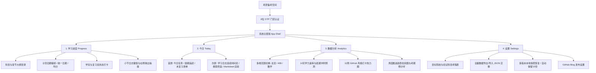
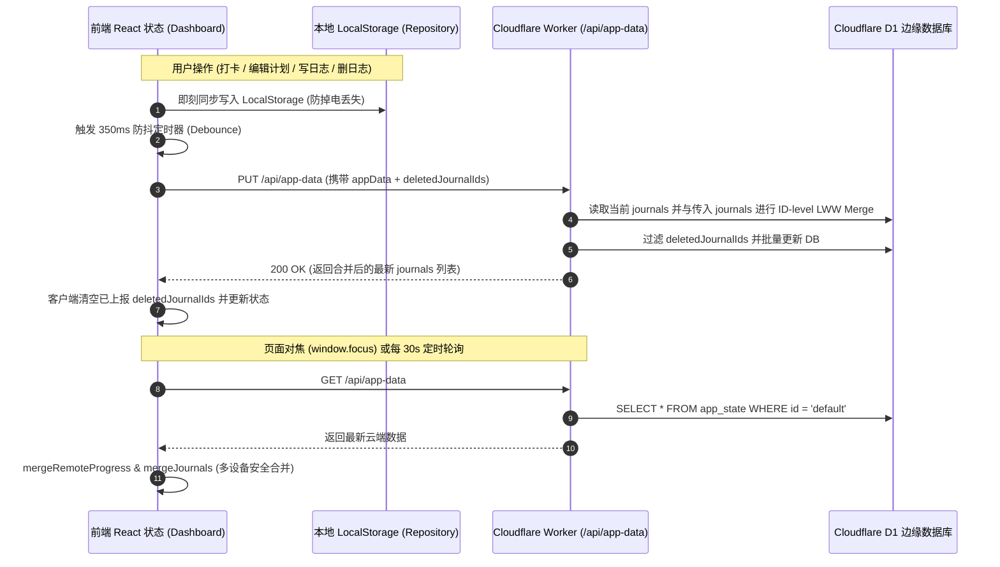

# 408 & 数学考研备考空间 · 全景功能架构与 V1.8-V1.9 迭代交接文档

> **文档性质**：系统全景功能交接 + V1.8/V1.9 迭代技术变更与安全强化记录  
> **适用对象**：团队交接研发人员、后续维护者、协同开发 Agent 知识库对齐  
> **当前系统版本**：`V1.8.0`（包含 V1.8 学习日志、V1.9 博客发布、KaTeX 安全引擎与多端 Merge 同步）  
> **当前 Schema 版本**：`schemaVersion: 2`  

---

## 目录
- [第一部分：考研备考空间全景功能梳理](#第一部分考研备考空间全景功能梳理)
  - [1.1 系统定位与整体架构](#11-系统定位与整体架构)
  - [1.2 页面层级与核心模块详述](#12-页面层级与核心模块详述)
    - [1.2.1「学习进度」页面 (Progress)](#121-学习进度页面-progress)
    - [1.2.2「今日」页面 (Today)](#122-今日页面-today)
    - [1.2.3「数据分析」页面 (Analytics)](#123-数据分析页面-analytics)
    - [1.2.4「设置」页面 (Settings)](#124-设置页面-settings)
  - [1.3 数据同步机制与多设备 Merge 策略](#13-数据同步机制与多设备-merge-策略)
  - [1.4 访问认证与安全性](#14-访问认证与安全性)
- [第二部分：V1.8 学习日志 & V1.9 Blog 发布迭代详解](#第二部分v18-学习日志--v19-blog-发布迭代详解)
  - [2.1 需求对齐与架构修正（PRD 差异校正）](#21-需求对齐与架构修正prd-差异校正)
  - [2.2 数据模型升级（Schema 1 → Schema 2）与 `JournalContext` 三级体系](#22-数据模型升级schema-1--schema-2与-journalcontext-三级体系)
  - [2.3 Markdown + KaTeX 数学公式解析与 XSS 安全防御](#23-markdown--katex-数学公式解析与-xss-安全防御)
  - [2.4 前端交互与重点组件交付](#24-前端交互与重点组件交付)
  - [2.5 真实 Blog 发布与模拟发布严格区分](#25-真实-blog-发布与模拟发布严格区分)
  - [2.6 数据库与 Serverless 后端 API 改造](#26-数据库与-serverless-后端-api-改造)
  - [2.7 自动化测试与工程质量保障](#27-自动化测试与工程质量保障)
- [第三部分：代码拓扑与文件索引](#第三部分代码拓扑与文件索引)
- [第四部分：已知未决风险与后续建议](#第四部分已知未决风险与后续建议)

---

# 第一部分：考研备考空间全景功能梳理

## 1.1 系统定位与整体架构

本项目是专为计算机考研（**408 计算机学科专业基础**：数据结构、计算机组成原理、操作系统、计算机网络）与**考研数学**（高等数学、线性代数、概率论与数理统计）量身打造的高效沉浸式备考管理与知识沉淀空间。

### 技术栈构成
- **前端框架**：Next.js (React 19) + `vinext` 构建引擎，纯原生 TypeScript 与 Vanilla CSS，无臃肿 UI 库依赖，追求极致的加载速度与排版质感。
- **排版美学**：采用经典学术人文风格（Noto Serif SC 衬线体标题、暖米纸色 `--paper: #fbfaf6`、深青墨黑 `--sidebar: #111b24`、珊瑚朱红 `--coral: #ef846d`）。
- **云端与存储**：Cloudflare Worker (Serverless API) + Cloudflare D1 (边缘 SQLite 数据库) + 本地 LocalStorage 双写。
- **数学与富文本**：KaTeX + Marked 打造的无冲突 LaTeX 解析与 XSS 过滤引擎。

---

## 1.2 页面层级与核心模块详述

系统严格遵循**四个一级 Tab**的顶级导航架构，兼顾桌面侧边栏与移动端底部 Dock 栏：



---

### 1.2.1「学习进度」页面 (Progress)

该页面是备考知识体系的主战场，以**书目 → 章节 → 小节**三层树状大纲为骨架。

1. **项目与科目切换**：
   - 顶部快捷切换两大备考大类：`408` 与 `数学`。
   - 侧边提供科目胶囊：数据结构、计算机组成原理、操作系统、计算机网络、高等数学、线性代数、概率论与数理统计。
2. **大纲卡片与折叠控制**：
   - 章节卡片展示序号、章节名称、计划跨度日期、第一轮/复习完成日期标签，以及章节完成度比例徽章（如 `12/12 ✓`）。
   - 支持多级展开/收起，记忆折叠状态。
3. **小节核心操作行 (Section Row)**：
   - **状态指示**：通过不同色彩指示状态（未计划、已计划待学、今日到期、逾期、第一轮已学完、第二轮已复习）。
   - **当前学习标记**：可将任意未完成小节设为「当前学习」，在列表置顶高亮并在导航栏展示。
   - **计划日期编辑**：支持单元格原地点击弹出日历修改；在「批量排期模式」下可直接对整章设定起始区间，并执行「统一日期」或「按天均分」，支持「区间移动（+N天 / -N天）」。
   - **打卡联动逻辑**：
     - 勾选「学完」：记录学完时间 `learnedAt`，自动同步状态。
     - 勾选「复习」：**严格前置依赖「学完」**（未学完项禁用复习勾选；若取消学完，弹出二次确认并同步清除复习记录）。
   - **日志联动徽章 (V1.8)**：展示 `📝 N 条记录` 徽章，并在鼠标悬浮时展示 `记录 +` 快捷按钮。点击徽章从屏幕右侧滑出 **Section Journal Drawer（小节日志抽屉）**，收录并回溯本小节的历史复盘。

---

### 1.2.2「今日」页面 (Today)

专为日常高频执行与主观思考设计的**两屏一体化**工作台：

1. **首屏：每日执行面板 (Execution Board)**
   - **顶部行动条**：展示今日日期农历/星期徽章，提供 `✍ 写今日记录` 核心按钮与 `↓ 学习日志 (N)` 页面内平滑跳转锚点。
   - **任务概览条**：统计今日应学项、已完成项、逾期积压数。
   - **三栏/折叠任务清单**：
     - `01 今日计划`：计划日期为今天的全部小节列表，支持即时打卡。
     - `02 逾期追赶`：计划日期早于今天但未学完的小节，按原计划日期由远及近智能排序，助力迅速消灭积压。
     - `03 未复习清单`：第一轮已学完但尚未完成复习的小节清单（首轮全部学完后自动展示）。

2. **次屏：学习日志时间流 (Journal Timeline Stream - V1.8/V1.9)**
   - **搜索与筛选条**：
     - 全文模糊搜索（支持正文、自定义标题、关联小节名称/编号）。
     - 6 个快速分类胶囊：`全部`、`无关联（纯时间流随笔）`、`有关联（绑定知识点）`、`408`、`数学`、`已发布（Blog）`。
   - **时间轴聚类 (Date Grouping)**：日志按自然日聚合分组（如 `8月14日 · 星期五`），左侧具备时间轴实线与节点实心圆。
   - **富文本日志卡片**：
     - 顶部元数据：时间戳（`16:20`）、关联上下文徽章（小节/科目/项目，点击小节徽章打开对应抽屉）、Blog 已发布外链徽章（点击直达 GitHub 博客）。
     - 操作区：`编辑`、`发布到 Blog`（若已发布则为 `重新发布`）、`删除`。
     - Markdown 正文：支持数学公式、表格、任务列表；长文（>280字）默认优雅截断，提供 `展开阅读全文 ↓` / `收起全文 ↑`。

---

### 1.2.3「数据分析」页面 (Analytics)

基于真实学习打卡行为大数据的可视化中枢：

1. **多维范围切换**：支持在「总览」、「408」、「数学」三种统计口径下实时重新计算全部指标。
2. **核心推进看板**：总小节数、第一轮学完率、第二轮复习率、当前计划覆盖度。
3. **学力速率与结课冲刺预测**：
   - 统计近 14 天的日均完成小节速率（小节/天）。
   - 依据剩余未学小节数，严谨推导出预计结课日期，并在考期倒计时前给出冲刺节奏预警。
4. **连续学习天数 (Streak Engine)**：
   - 采用「回溯断点探测」算法：自最近一次打卡日起向前逐日追溯，即使今天尚未开始打卡，只要昨天有记录就不会发生断连归零误判。
5. **12 周活动热力图 (GitHub-style Activity Heatmap)**：
   - 过去 84 天的日历网格，按每日学完/复习量呈现 4 级翡翠绿渐变，悬浮提供 Tooltip 详细提示。
6. **周度学习趋势柱状图**：按周统计学完与复习量对比，清晰反映备考状态起伏。

---

### 1.2.4「设置」页面 (Settings)

1. **考研项目与目标设定**：设定目标院校、专业代号与目标总分。
2. **统考初试日程表**：
   - 联动展示初试第一天（政治、英语）与第二天（数学、408）的准考时间与分值。
   - 修改考研基准日期自动全域同步所有倒计时组件。
3. **数据管理与多版本快照**：
   - **全量 JSON 导出**：导出包含两项目全部小节状态、计划编排、设置、历史、以及 V1.8/V1.9 学习日志的单一规范 JSON。
   - **JSON 导入与合规校验**：导入时执行严谨的 Schema 校验与逻辑修复，导入前**自动触发本地快照备份**。
   - **多版本本地快照管理**：支持手动创建快照，并在「导入前」、「恢复前」、「版本升级前」自动备份，按时间倒序最多保留 15 份快照，支持一键恢复。
4. **Blog 发布配置卡片 (V1.9)**：
   - 呈现个人公开博客站点 `https://craig9re5.github.io/`，展示基于 Cloudflare Worker Serverless 网关的零 Token 泄露安全架构。

---

## 1.3 数据同步机制与多设备 Merge 策略



- **双写与防抖**：本地 LocalStorage 秒级持久化；350ms 防抖同步至 Cloudflare D1。
- **日志多设备合并算法 (`mergeJournals`)**：
  - 以日志的唯一 ID (`id`) 建立索引并取全集（Union）。
  - 若双端存在相同 ID（并发修改同一篇日志），比较 `updatedAt` 时间戳，以更新时间较晚者为准（LWW - Last Write Wins）。
  - **防止静默相互覆盖**：设备 A 在离线或并发时创建的日志 1 与设备 B 创建的日志 2 在同步时会完整合并保留，不会丢失任何一篇新建日志。
- **删除同步与墓碑管理**：
  - 客户端通过 `deletedJournalIdsRef` 记录本次会话中主动删除的日志 ID，在 `PUT` 负载中显式上报，Worker 在持久化前精确剔除，确保已删除项不会被 Merge 机制错误复活。

---

## 1.4 访问认证与安全性

- **6 位数字 PIN 码安全门禁**：
  - 进入系统需输入 6 位访问码，界面提供数字分格输入体验、自动焦点切换与错误震动反馈。
  - 会话基于安全 HttpOnly Cookie（`session_id`），在 Worker 侧采用常量时间比对（防止时序攻击）。
- **零秘钥暴露原则**：所有需要调用第三方外部 API（如 GitHub API 发布文章）的操作，前端均只请求 `/api/blog/publish` 内部接口，GitHub Personal Access Token (PAT) 仅存放在 Cloudflare Worker 环境变量 Secrets（`GITHUB_TOKEN`）中。

---

# 第二部分：V1.8 学习日志 & V1.9 Blog 发布迭代详解

## 2.1 需求对齐与架构修正（PRD 差异校正）

在开发启动前，我们将过时的 `docs/V1.8-V1.9-Journal-Blog-PRD.md` 与当前系统的实际架构进行了对齐，修正了以下关键偏差：

| 维度 | 旧版 PRD 的设想 | 本次迭代最终落地的架构决策（原因） |
| :--- | :--- | :--- |
| **顶级导航架构** | 提议新增第 5 个顶级 Tab「学习日志」 | **坚决保持 4 个一级 Tab**。将日志有机融入「今日」第二屏时间流，并在「学习进度」小节上提供抽屉式回溯，避免信息孤岛与割裂感。 |
| **关联小节标识** | 伪造扁平字符串 `cs408-os-ch2-cpu` | **严谨复用系统实际拓扑**：底层支持 `project \| subject \| section` 三级体系。 |
| **数据存储与多端同步** | 仅提议 LocalStorage 本地存储 | **升级 Cloudflare D1 边缘数据库**，增加基于 ID 与时间戳的 `mergeJournals` 机制，解决并发写入相互覆盖问题。 |
| **博客发布实现方式** | 提议前端直接持有 GitHub PAT 发起请求 | **采用 Serverless 安全网关**。前端请求 `/api/blog/publish`，由 Cloudflare Worker 代理调用 GitHub，彻底规避 Token 泄露风险。 |
| **模拟发布与真实发布** | 模拟与真实发布均打上 published 标记 | **严格隔离模拟发布**。未配置 `GITHUB_TOKEN` 时返回 `simulated: true`，前端绝不修改 `publish.status` 为 `published`。 |

---

## 2.2 数据模型升级（Schema 1 → Schema 2）与 `JournalContext` 三级体系

### 1. `JournalContext` 三级可辨识联合类型（[app/study-data.ts](file:///d:/%23Review/408/Web/app/study-data.ts)）

底层数据模型完整支持项目级、科目级、小节级三种粒度，在保证底层拓展性的同时，V1.8/V1.9 UI 保持轻量（聚焦「不关联」与「关联一个小节」）：

```typescript
export type JournalProjectContext = {
  type: "project";
  area: StudyArea; // "408" | "math"
};

export type JournalSubjectContext = {
  type: "subject";
  area: StudyArea;
  bookId: string;
  bookTitle?: string;
};

export type JournalSectionContext = {
  type: "section";
  area: StudyArea;
  bookId: string;
  sectionId: string;
  bookTitle?: string;
  sectionTitle?: string;
  sectionNumber?: string;
};

export type JournalContext =
  | JournalProjectContext
  | JournalSubjectContext
  | JournalSectionContext;
```

### 2. `JournalEntry` 统一核心数据模型

```typescript
export type JournalPublish = {
  status: "local" | "published";
  publishedAt: string | null;
  blogUrl: string | null;
  blogPostId: string | null; // 文章 Slug / ID
};

export type JournalEntry = {
  id: string;                    // 稳定单调 ID，格式 YYYYMMDDxxx (如 "20260814001")
  createdAt: string;             // ISO 8601 UTC
  updatedAt: string;             // ISO 8601 UTC
  title: string | null;          // 可选标题，为 null 时以正文优先呈现
  content: string;               // Markdown 正文 (支持 KaTeX 公式)
  context: JournalContext | null;// null 为纯时间流随笔
  publish: JournalPublish;       // Blog 发布状态元数据
};
```

---

## 2.3 Markdown + KaTeX 数学公式解析与 XSS 安全防御

针对公式与 Markdown 语法冲突（如 `_` 和 `*`）以及富文本 XSS 攻击向量，在 [app/lib/markdown.ts](file:///d:/%23Review/408/Web/app/lib/markdown.ts) 构建了严谨的**七阶段安全处理流水线**：

```
[原始 Markdown 输入]
  │
  ├─ 1. 屏蔽代码块 (```...``` 和 ~~~...~~~) ──> %%CODE_BLOCK_n%%
  ├─ 2. 屏蔽行内代码 (`...` 和 ``...``) ──────> %%INLINE_CODE_n%%
  ├─ 3. 屏蔽转义美元符号 (\$ ) ────────────────> %%ESCAPED_DOLLAR_n%%
  ├─ 4. 屏蔽多行块级公式 ($$...$$) ────────────> %%KATEX_BLOCK_n%%
  ├─ 5. 屏蔽行内公式 ($...$) ──────────────────> %%KATEX_INLINE_n%%
  ├─ 6. 原生 HTML 标签转义 (< 和 > 转义为 &lt; &gt;，中和恶意标签)
  ├─ 7. 回填还原代码块、行内代码与转义字符
  ├─ 8. marked.parse 执行 GFM 解析 (表格、Task List、代码高亮)
  ├─ 9. sanitizeHtml 深度清理 (中和 javascript:/vbscript: 伪协议与 onerror 等事件)
  ├─ 10. KaTeX 渲染回填 (公式 MathML/HTML 节点注入)
  │
[最终安全 HTML 输出]
```

### 边界保护与安全特性
- **转义与代码块隔离**：代码块与行内代码中的 `$`（如 `$ npm test` 或 `$variable`）以及 `\$` 绝不触发 KaTeX 解析。
- **复杂公式保护**：多行矩阵 `\begin{cases}`、下标 `x_i^*`、行列式 `\det |A|` 中的 `_`、`*`、`\\`、`|` 绝不会被 Markdown 错误转换为 `<em>` 或表格破损。
- **XSS 彻底封杀**：原生 `<script>`、``、`<iframe ...>` 均转义为纯文本呈现；`[link](javascript:...)` 的危险协议自动被中和为 `href="#"`。

---

## 2.4 前端交互与重点组件交付

1. **今日页面：两屏一体化与日志时间流**：
   - 顶部提供今日日期与 `✍ 写今日记录` 按钮、`↓ 学习日志` 锚点；次屏包含搜索、6 类胶囊筛选与自然日聚类卡片。
2. **小节记录抽屉 (Section Drawer)**：
   - 小节行提供 `📝 N 条记录` 徽章与 hover `记录 +` 按钮，点击从右侧滑出抽屉，专注聚合当前小节的所有心得。
3. **分栏实时编辑器 (Journal Editor Modal)**：
   - 桌面端支持 `[编辑]` / `[分栏]` / `[预览]`，移动端单列自适应；支持标题折叠输入与小节上下文选择器。

---

## 2.5 真实 Blog 发布与模拟发布严格区分

在 [worker/api.ts](file:///d:/%23Review/408/Web/worker/api.ts) 与 [app/study-dashboard.tsx](file:///d:/%23Review/408/Web/app/study-dashboard.tsx) 中严格区分了开发环境模拟与生产真实发布：

1. **未配置 `GITHUB_TOKEN`（本地开发/演示环境）**：
   - `/api/blog/publish` 校验入参格式无误后，返回 `{ success: true, simulated: true, message: "..." }`。
   - 前端接收到 `simulated: true` 时，**明确提示「模拟发布成功」，绝不修改日志的 `publish.status`（保持 `local`）**，避免虚假发布状态污染。
2. **已配置 `GITHUB_TOKEN`（生产线上环境）**：
   - 后端代理调用 GitHub API 在目标仓库（`craig9re5/craig9re5.github.io`）的 `_posts/` 下提交 Commit。
   - GitHub 写入成功后返回 `{ success: true, simulated: false, publishedAt, blogUrl, blogPostId }`。
   - 前端方将该日志状态更新为 `publish.status = "published"`，卡片生成 `🌐 已发布 ↗` 博客外链。

---

## 2.6 数据库与 Serverless 后端 API 改造

1. **D1 迁移脚本（[migrations/0005_add_journals.sql](file:///d:/%23Review/408/Web/migrations/0005_add_journals.sql)）**：
   - 为 `app_state` 表添加 `journals TEXT NOT NULL DEFAULT '[]'`。
2. **`PUT /api/app-data` 接口增强**：
   - 支持读取 D1 现有日志进行 `mergeJournals` 合并。
   - 接收 `deletedJournalIds` 并执行可靠物理删除，返回合并后的最终日志数组。

---

## 2.7 自动化测试与工程质量保障

[tests/journal-v1.8-v1.9.test.mjs](file:///d:/%23Review/408/Web/tests/journal-v1.8-v1.9.test.mjs) 覆盖了全部边界条件与核心业务逻辑：

```bash
> npm test
✔ 1. Journal ID: 单调自增且删除后不会复用序号
✔ 2. JournalContext: 底层支持 project / subject / section 三级结构并容错
✔ 3. Journal 数据标准化: 校验并填充默认结构与发布状态
✔ 4. Schema 自动升级: V1 数据无缝迁移为 V2 并带有 journals 数组
✔ 5. Markdown XSS 安全防护: 阻断 script/onerror/javascript 伪协议注入
✔ 6. Markdown + KaTeX 边界测试: 转义符、代码块中包含$、连续与多行公式
✔ 7. 多设备同步冲突: mergeJournals 基于 ID 和时间戳实现无丢失合并
✔ 8. Markdown Summary: 准确截取前缀纯文本并忽略公式特殊符号
✔ 9. createAppData: 打包导出数据包含 journals 与最新 schema
✔ 10-21. 既有 12 项进度、复习规则、打卡连续性与快照回归测试
总计 21 项测试全部 PASS (100% 成功率)
```

- **类型检查**：`npm run typecheck`（`tsc --noEmit`）零错误。
- **代码规范**：`npm run lint`（ESLint）零错误。

---

# 第三部分：代码拓扑与文件索引

```
d:/#Review/408/Web/
├── app/
│   ├── components/
│   │   └── markdown-renderer.tsx   # 支持公式与 GFM 的 React 渲染组件
│   ├── data/
│   │   └── books.ts                # 408 与 数学科目章节静态拓扑大纲
│   ├── lib/
│   │   └── markdown.ts             # 纯 TS 编写的 Markdown + KaTeX 解析、XSS 过滤与截断引擎
│   ├── globals.css                 # 全局样式（含日志时间流、抽屉、分栏编辑器、KaTeX）
│   ├── layout.tsx                  # 引入 KaTeX 样式外链
│   ├── study-dashboard.tsx         # 核心控制台（整合今日第二屏、小节徽章抽屉、分栏编辑器、发布弹窗与 Merge 同步）
│   └── study-data.ts               # 数据层（Schema 2、Journal 类型、ID 生成、Context 归一化、mergeJournals）
├── docs/
│   ├── 408-study-v1.1-v1.3-prd.md  # 历史 PRD
│   ├── V1.8-V1.9-Journal-Blog-PRD.md # 初始 PRD
│   └── SYSTEM_ARCHITECTURE_AND_V1.8_V1.9_CHANGELOG.md # 本交接与全景架构文档
├── migrations/
│   ├── 0001_initial_schema.sql
│   ├── ...
│   └── 0005_add_journals.sql       # D1 数据库增加 journals 字段迁移脚本
├── tests/
│   ├── journal-v1.8-v1.9.test.mjs  # Journal、Context、KaTeX 边界、XSS 与 Merge 针对性单元测试
│   ├── prd-v1.1-v1.3.test.mjs      # 既有排期与复习回归测试
│   └── rendered-html.test.mjs      # 既有状态与备份回归测试
├── worker/
│   └── api.ts                      # Cloudflare Worker 后端（D1 同步 Merge、删除过滤与 /api/blog/publish 发布网关）
└── package.json                    # 依赖配置与测试脚本
```

---

# 第四部分：已知未决风险与后续建议

虽然本次迭代已通过 `mergeJournals` 解决了**多设备并发新建日志互相覆盖**的问题，并在 XSS 和公式边界上进行了全方位加固，但针对高并发和复杂网络场景，后续维护人员需注意以下已知设计边界：

1. **并发修改同一篇日志的行级冲突**：
   - 当前在双端同时修改同一篇 Journal 正文时，依据 `updatedAt` 时间戳进行 LWW（最后写入者胜出）整篇覆盖，未引入文本 Diff 级三方合并。对于个人单人多设备复习场景完全够用，但若多端秒级高频同时编辑同一篇文章，可能会保留最后保存端的内容。
2. **离线删除与冷启动墓碑生命周期**：
   - 客户端删除通过 `deletedJournalIdsRef` 在当前会话生命周期内上报并由服务端过滤。若设备 A 在完全断网状态下删除了日志，随后长期未联网（关闭浏览器导致内存丢失 `deletedJournalIds`），再次连网拉取全量云端数据时，该日志可能会被云端重新合并下载。后续可在本地数据库中增加持久化软删除墓碑记录（Tombstone）以进一步加固超长周期离线删除。
3. **GitHub API 速率限制 (Rate Limit)**：
   - 个人 PAT 在 GitHub API 拥有 5000 次/小时配额，对于博客发布频率绰绰有余。若需扩展为多用户并发发布，需在 Worker 侧增加队列缓冲或重试机制。
