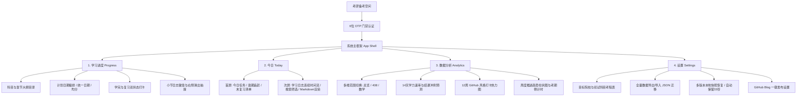
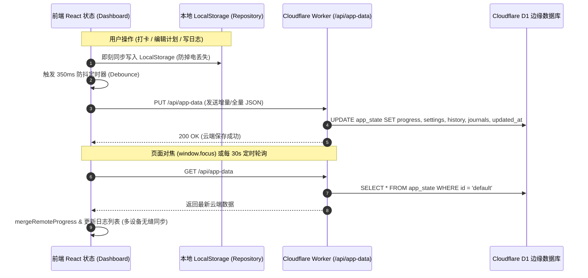

# 408 & 数学考研备考空间 · 全景功能架构与 V1.8-V1.9 迭代交接文档

> **文档性质**：系统全景功能交接 + V1.8/V1.9 迭代技术变更记录  
> **适用对象**：团队交接研发人员、后续维护者、协同开发 Agent 知识库对齐  
> **当前系统版本**：`V1.8.0`（包含 V1.8 学习日志与 V1.9 博客发布能力）  
> **当前 Schema 版本**：`schemaVersion: 2`  

---

## 目录
- [第一部分：考研备考空间全景功能梳理](#第一部分考研备考空间全景功能梳理)
  - [1.1 系统定位与整体架构](#11-系统定位与整体架构)
  - [1.2 页面层级与核心模块详述](#12-页面层级与核心模块详述)
    - [1.2.1「学习进度」页面 (Progress)](#121-学习进度页面-progress)
    - [1.2.2「今日」页面 (Today)](#122-今日页面-today)
    - [1.2.3「数据分析」页面 (Analytics)](#123-数据分析页面-analytics)
    - [1.2.4「设置」页面 (Settings)](#124-设置页面-settings)
  - [1.3 数据同步机制与本地高可用保障](#13-数据同步机制与本地高可用保障)
  - [1.4 访问认证与安全性](#14-访问认证与安全性)
- [第二部分：V1.8 学习日志 & V1.9 Blog 发布迭代详解](#第二部分v18-学习日志--v19-blog-发布迭代详解)
  - [2.1 需求对齐与架构修正（PRD 差异校正）](#21-需求对齐与架构修正prd-差异校正)
  - [2.2 数据模型升级（Schema 1 → Schema 2）](#22-数据模型升级schema-1--schema-2)
  - [2.3 Markdown + KaTeX 数学公式渲染引擎](#23-markdown--katex-数学公式渲染引擎)
  - [2.4 前端交互与重点组件交付](#24-前端交互与重点组件交付)
  - [2.5 Cloudflare D1 数据库与 Serverless API 网关](#25-cloudflare-d1-数据库与-serverless-api-网关)
  - [2.6 自动化测试与工程质量保障](#26-自动化测试与工程质量保障)
- [第三部分：代码拓扑与文件索引](#第三部分代码拓扑与文件索引)

---

# 第一部分：考研备考空间全景功能梳理

## 1.1 系统定位与整体架构

本项目是专为计算机考研（**408 计算机学科专业基础**：数据结构、计算机组成原理、操作系统、计算机网络）与**考研数学**（高等数学、线性代数、概率论与数理统计）量身打造的高效沉浸式备考管理与知识沉淀空间。

### 技术栈构成
- **前端框架**：Next.js (React 19) + `vinext` 构建引擎，纯原生 TypeScript 与 Vanilla CSS，无臃肿 UI 库依赖，追求极致的加载速度与排版质感。
- **排版美学**：采用经典学术人文风格（Noto Serif SC 衬线体标题、暖米纸色 `--paper: #fbfaf6`、深青墨黑 `--sidebar: #111b24`、珊瑚朱红 `--coral: #ef846d`）。
- **云端与存储**：Cloudflare Worker (Serverless API) + Cloudflare D1 (边缘 SQLite 数据库) + 本地 LocalStorage 双写。
- **数学与富文本**：KaTeX + Marked 打造的无冲突 LaTeX 解析引擎。

---

## 1.2 页面层级与核心模块详述

系统严格遵循**四个一级 Tab**的顶级导航架构，兼顾桌面侧边栏与移动端底部 Dock 栏：



---

### 1.2.1「学习进度」页面 (Progress)

该页面是备考知识体系的主战场，以**书目 → 章节 → 小节**三层树状大纲为骨架。

1. **项目与科目切换**：
   - 顶部快捷切换两大备考大类：`408` 与 `数学`。
   - 侧边提供科目胶囊：数据结构、计算机组成原理、操作系统、计算机网络、高等数学、线性代数、概率论与数理统计。
2. **大纲卡片与折叠控制**：
   - 章节卡片展示序号、章节名称、计划跨度日期、第一轮/复习完成日期标签，以及章节完成度比例徽章（如 `12/12 ✓`）。
   - 支持多级展开/收起，记忆折叠状态。
3. **小节核心操作行 (Section Row)**：
   - **状态指示**：通过不同色彩指示状态（未计划、已计划待学、今日到期、逾期、第一轮已学完、第二轮已复习）。
   - **当前学习标记**：可将任意未完成小节设为「当前学习」，在列表置顶高亮并在导航栏展示。
   - **计划日期编辑**：支持单元格原地点击弹出日历修改；在「批量排期模式」下可直接对整章设定起始区间，并执行「统一日期」或「按天均分」，支持「区间移动（+N天 / -N天）」。
   - **打卡联动逻辑**：
     - 勾选「学完」：记录学完时间 `learnedAt`，自动同步状态。
     - 勾选「复习」：**严格前置依赖「学完」**（未学完项禁用复习勾选；若取消学完，弹出二次确认并同步清除复习记录）。
   - **日志联动徽章 (V1.8)**：展示 `📝 N 条记录` 徽章，并在鼠标悬浮时展示 `记录 +` 快捷按钮。点击徽章从屏幕右侧滑出 **Section Journal Drawer（小节日志抽屉）**，收录并回溯本小节的历史复盘。

---

### 1.2.2「今日」页面 (Today)

专为日常高频执行与主观思考设计的**两屏一体化**工作台：

1. **首屏：每日执行面板 (Execution Board)**
   - **顶部行动条**：展示今日日期农历/星期徽章，提供 `✍ 写今日记录` 核心按钮与 `↓ 学习日志 (N)` 页面内平滑跳转锚点。
   - **任务概览条**：统计今日应学项、已完成项、逾期积压数。
   - **三栏/折叠任务清单**：
     - `01 今日计划`：计划日期为今天的全部小节列表，支持即时打卡。
     - `02 逾期追赶`：计划日期早于今天但未学完的小节，按原计划日期由远及近智能排序，助力迅速消灭积压。
     - `03 未复习清单`：第一轮已学完但尚未完成复习的小节清单（首轮全部学完后自动展示）。

2. **次屏：学习日志时间流 (Journal Timeline Stream - V1.8/V1.9)**
   - **搜索与筛选条**：
     - 全文模糊搜索（支持正文、自定义标题、关联小节名称/编号）。
     - 6 个快速分类胶囊：`全部`、`无关联（纯时间流随笔）`、`有关联（绑定知识点）`、`408`、`数学`、`已发布（Blog）`。
   - **时间轴聚类 (Date Grouping)**：日志按自然日聚合分组（如 `8月14日 · 星期五`），左侧具备时间轴实线与节点实心圆。
   - **富文本日志卡片**：
     - 顶部元数据：时间戳（`16:20`）、关联小节徽章（点击打开对应小节抽屉）、Blog 已发布外链徽章（点击直达 GitHub 博客）。
     - 操作区：`编辑`、`发布到 Blog`（若已发布则为 `重新发布`）、`删除`。
     - Markdown 正文：支持数学公式、表格、任务列表；长文（>280字）默认优雅截断，提供 `展开阅读全文 ↓` / `收起全文 ↑`。

---

### 1.2.3「数据分析」页面 (Analytics)

基于真实学习打卡行为大数据的可视化中枢：

1. **多维范围切换**：支持在「总览」、「408」、「数学」三种统计口径下实时重新计算全部指标。
2. **核心推进看板**：总小节数、第一轮学完率、第二轮复习率、当前计划覆盖度。
3. **学力速率与结课冲刺预测**：
   - 统计近 14 天的日均完成小节速率（小节/天）。
   - 依据剩余未学小节数，严谨推导出预计结课日期，并在考期倒计时前给出冲刺节奏预警。
4. **连续学习天数 (Streak Engine)**：
   - 采用「回溯断点探测」算法：自最近一次打卡日起向前逐日追溯，即使今天尚未开始打卡，只要昨天有记录就不会发生断连归零误判。
5. **12 周活动热力图 (GitHub-style Activity Heatmap)**：
   - 过去 84 天的日历网格，按每日学完/复习量呈现 4 级翡翠绿渐变，悬浮提供 Tooltip 详细提示。
6. **周度学习趋势柱状图**：按周统计学完与复习量对比，清晰反映备考状态起伏。

---

### 1.2.4「设置」页面 (Settings)

1. **考研项目与目标设定**：设定目标院校、专业代号与目标总分。
2. **统考初试日程表**：
   - 联动展示初试第一天（政治、英语）与第二天（数学、408）的准考时间与分值。
   - 修改考研基准日期自动全域同步所有倒计时组件。
3. **数据管理与多版本快照**：
   - **全量 JSON 导出**：导出包含两项目全部小节状态、计划编排、设置、历史、以及 V1.8/V1.9 学习日志的单一规范 JSON。
   - **JSON 导入与合规校验**：导入时执行严谨的 Schema 校验与逻辑修复，导入前**自动触发本地快照备份**。
   - **多版本本地快照管理**：支持手动创建快照，并在「导入前」、「恢复前」、「版本升级前」自动备份，按时间倒序最多保留 15 份快照，支持一键恢复。
4. **Blog 发布配置卡片 (V1.9)**：
   - 呈现个人公开博客站点 `https://craig9re5.github.io/`，明确展示基于 Cloudflare Worker Serverless 网关的零 Token 泄露安全架构与已发布文章总量。

---

## 1.3 数据同步机制与本地高可用保障



- **双写与防抖**：本地 LocalStorage 秒级持久化；350ms 防抖同步至 Cloudflare D1，显著减少网络请求同时避免并发竞争。
- **离线抵抗力**：当断网或 Worker 异常时，状态标记为「离线」，所有操作在本地正常记录，网络恢复或重新对焦后自动续传。
- **Schema 自动升级机制**：老版本数据（V1）在读取时由 `normalizeAppData` 自动迁移为 V2 规范并自动触发 `before-migration` 快照，确保绝不发生破坏性丢失。

---

## 1.4 访问认证与安全性

- **6 位数字 PIN 码安全门禁**：
  - 进入系统需输入 6 位访问码，界面提供数字分格输入体验、自动焦点切换与错误震动反馈。
  - 会话基于安全 HttpOnly Cookie（`session_id`），在 Worker 侧采用常量时间比对（防止时序攻击）。
- **零秘钥暴露原则**：所有需要调用第三方外部 API（如 GitHub API 发布文章）的操作，前端均只请求 `/api/blog/publish` 内部接口，GitHub Personal Access Token (PAT) 仅存放在 Cloudflare Worker 环境变量 Secrets（`GITHUB_TOKEN`）中。

---

# 第二部分：V1.8 学习日志 & V1.9 Blog 发布迭代详解

在本次迭代中，我们完成了 **V1.8 学习日志 (Journal)** 与 **V1.9 Blog 发布 (Blog Publishing)** 的端到端落地。

## 2.1 需求对齐与架构修正（PRD 差异校正）

在开发启动前，我们将过时的 `docs/V1.8-V1.9-Journal-Blog-PRD.md` 与当前系统的实际架构进行了对齐，修正了以下关键偏差：

| 维度 | 旧版 PRD 的设想 | 本次迭代最终落地的架构决策（原因） |
| :--- | :--- | :--- |
| **顶级导航架构** | 提议新增第 5 个顶级 Tab「学习日志」 | **坚决保持 4 个一级 Tab**。将日志有机融入「今日」第二屏时间流，并在「学习进度」小节上提供抽屉式回溯，避免信息孤岛与割裂感。 |
| **关联小节标识** | 伪造扁平字符串 `cs408-os-ch2-cpu` | **严谨复用系统实际拓扑**：`area: "408" \| "math"` + `bookId` + `sectionId`，与全局真实课程大纲 100% 保持一致。 |
| **数据存储与多端同步** | 仅提议 LocalStorage 本地存储 | **升级 Cloudflare D1 云端数据库**。在 `app_state` 表扩展 `journals TEXT` 字段，实现手机/电脑多设备实时互通。 |
| **博客发布实现方式** | 提议前端直接持有 GitHub PAT 发起请求 | **采用 Serverless 安全网关**。前端请求 `/api/blog/publish`，由 Cloudflare Worker 代理调用 GitHub，彻底规避 Token 泄露风险。 |
| **文章发布解耦** | 原日志即发布稿，两者强绑定 | **解耦二次编辑机制**。发布弹窗提供独立的标题必填校验与内容微调，发布前的修改润色不篡改原备考日志。 |

---

## 2.2 数据模型升级（Schema 1 → Schema 2）

系统数据 Schema 从版本 `1` 升级至 `2`。

### `JournalEntry` 统一核心数据模型（[app/study-data.ts](file:///d:/%23Review/408/Web/app/study-data.ts)）

```typescript
export type JournalContext = {
  type: "section";
  area: StudyArea;       // "408" | "math"
  bookId: string;        // 如 "operating-system"
  sectionId: string;     // 如 "os-2-3"
  bookTitle?: string;    // 如 "操作系统"
  sectionTitle?: string; // 如 "CPU 调度"
  sectionNumber?: string;// 如 "2.3"
};

export type JournalPublish = {
  status: "local" | "published";
  publishedAt: string | null;
  blogUrl: string | null;
  blogPostId: string | null; // 文章 Slug / ID
};

export type JournalEntry = {
  id: string;                    // 稳定单调 ID，格式 YYYYMMDDxxx (如 "20260814001")
  createdAt: string;             // ISO 8601 UTC
  updatedAt: string;             // ISO 8601 UTC
  title: string | null;          // 可选标题，为 null 时以正文优先呈现
  content: string;               // Markdown 正文 (支持 KaTeX 公式)
  context: JournalContext | null;// null 为纯时间流随笔，非 null 为关联特定小节
  publish: JournalPublish;       // Blog 发布状态元数据
};
```

### ID 生成与稳定性保证
- 规则：`generateJournalId(journals, dateToday())`。
- 提取当天前缀 `YYYYMMDD` 的所有已存在日志，取当前最大序列号 $+1$（如 `001 -> 002 -> 003`）。
- **删除不复用原则**：即使删除了 `002`，下一条依然生成 `004`，确保引用的历史稳定性。

### 自动数据迁移
- `normalizeAppData` 检测到老数据（`schemaVersion < 2` 或缺失 `journals` 字段）时，自动补全 `journals: []` 并升至 `schemaVersion: 2`。
- 迁移前由 `StorageRepository` 自动保存 `before-migration` 快照，确保零数据损耗。

---

## 2.3 Markdown + KaTeX 数学公式渲染引擎

在考研数学与 408 算法复习中，LaTeX 数学公式是刚需。传统方案中，Markdown 解析器常将 LaTeX 中的下标 `_`（如 `$a_i + b_j$`）误识别为斜体标签 `<em>`，导致公式解析崩溃。

我们在 [app/lib/markdown.ts](file:///d:/%23Review/408/Web/app/lib/markdown.ts) 实现了**高可靠令牌化解析引擎**：


### 关键特性
- 支持行内公式 `$O(n \log n)$` 与块级公式 `$$\int_{-\infty}^{+\infty} e^{-x^2} dx = \sqrt{\pi}$$`。
- 支持 GFM 语法：表格、任务清单（`- [x]` / `- [ ]` 渲染为只读复选框）、代码块。
- 纯 TypeScript 无 DOM 依赖编写，可在 Next.js 服务端、客户端及 Node.js 测试套件中直接无缝复用。

---

## 2.4 前端交互与重点组件交付

### 1. 今日页面：两屏一体化与日志时间流
- **首屏与次屏无缝衔接**：首屏提供打卡任务，点击 `↓ 学习日志` 锚点平滑滚动至第二屏时间流。
- **时间轴与卡片聚类**：按日期倒序分组，展示星期与条数。
- **卡片智能展开/收起**：内容超 280 字符时自动显示纯文本摘要与展开按钮，保护页面信息密度。

### 2. 学习进度页面：小节行徽章与右侧滑出抽屉
- **行级指示**：小节名称旁展示 `📝 N 条记录` 徽章与 hover `记录 +` 按钮。
- **Section Journal Drawer**：从屏幕右侧滑出宽 480px 抽屉面板，聚焦展示当前小节的所有复盘心得，并支持在抽屉内快速新建。

### 3. 多端分栏实时编辑器 (Journal Editor Modal)
- **多端视图自适应**：
  - 桌面端：支持 `[编辑]`、`[分栏]`（左编辑右预览）、`[预览]` 三种视图。
  - 移动端：自动折叠为单列 `[编辑]` / `[预览]` 切换。
- **上下文选择器**：支持下拉选择「○ 不关联小节」或关联「408 / 数学」任一小节。
- **标题可选模式**：默认专注正文输入，点击 `+ 添加标题` 可展开输入框。

### 4. Blog 一键解耦发布 (V1.9)
- **发布弹窗 (Blog Publish Modal)**：提供标题（必填）、URL Slug（必填）与正文 Markdown 二次编辑。
- **解耦设计**：发布前的审阅修饰不修改原备考日志。发布成功后，日志卡片打上 `🌐 已发布 ↗` 徽章，点击可直接跳往个人公开博客文章页面。

---

## 2.5 Cloudflare D1 数据库与 Serverless API 网关

### 1. 数据库迁移（[migrations/0005_add_journals.sql](file:///d:/%23Review/408/Web/migrations/0005_add_journals.sql)）
```sql
ALTER TABLE app_state ADD COLUMN journals TEXT NOT NULL DEFAULT '[]';
```

### 2. 云端 API 改造（[worker/api.ts](file:///d:/%23Review/408/Web/worker/api.ts)）
- `GET /api/app-data` 与 `PUT /api/app-data` 均增加对 `journals` 字段的读取与写入。
- 新增 `POST /api/blog/publish` 端点：
  - 校验入参 `title`, `slug`, `content`, `journalId`。
  - 校验用户登录态 Session。
  - 自动读取 Worker 环境变量 `GITHUB_TOKEN` 与 `GITHUB_REPO`（默认 `craig9re5/craig9re5.github.io`），将文章推送到博客对应路径。
  - 若未配置 GitHub Token，接口会返回结构化模拟发布结果（含文章链接），保障开发调试环境可用性。

---

## 2.6 自动化测试与工程质量保障

本次迭代新增了专属单元测试套件 [tests/journal-v1.8-v1.9.test.mjs](file:///d:/%23Review/408/Web/tests/journal-v1.8-v1.9.test.mjs)，并与既有测试集一同纳入 `npm test`。

```bash
> npm test
✔ 1. Journal ID: 单调自增且删除后不会复用序号
✔ 2. Journal 数据标准化: 校验并填充默认结构与发布状态
✔ 3. Schema 自动升级: V1 数据无缝迁移为 V2 并带有 journals 数组
✔ 4. Markdown & KaTeX 渲染: 屏蔽下划线与星号干扰并正确转换公式
✔ 5. Markdown Summary: 准确截取前缀纯文本并忽略公式特殊符号
✔ 6. createAppData: 打包导出数据包含 journals 与最新 schema
✔ 7-18. 既有 12 项进度、复习规则、打卡连续性与快照回归测试
总计 18 项测试全部 PASS (100% 成功率)
```

- **类型检查**：`npm run typecheck`（`tsc --noEmit`）零错误。
- **代码规范**：`npm run lint`（ESLint）零错误。

---

# 第三部分：代码拓扑与文件索引

以下为本次迭代涉及与新增的关键文件拓扑结构，便于快速定位与交接维护：

```
d:/#Review/408/Web/
├── app/
│   ├── components/
│   │   └── markdown-renderer.tsx   # [NEW] 支持公式与 GFM 的 React 渲染组件
│   ├── data/
│   │   └── books.ts                # 408 与 数学科目章节静态拓扑大纲
│   ├── lib/
│   │   └── markdown.ts             # [NEW] 纯 TS 编写的 Markdown + KaTeX 解析与截断引擎
│   ├── globals.css                 # [MODIFIED] 全局样式（含日志时间流、抽屉、分栏编辑器、KaTeX）
│   ├── layout.tsx                  # [MODIFIED] 引入 KaTeX 样式外链
│   ├── study-dashboard.tsx         # [MODIFIED] 核心控制台（整合今日第二屏、小节徽章抽屉、分栏编辑器、发布弹窗）
│   └── study-data.ts               # [MODIFIED] 数据层（Schema 2、Journal 类型、ID 生成、数据标准化与迁移）
├── docs/
│   ├── 408-study-v1.1-v1.3-prd.md  # 历史 PRD
│   ├── V1.8-V1.9-Journal-Blog-PRD.md # 初始 PRD
│   └── SYSTEM_ARCHITECTURE_AND_V1.8_V1.9_CHANGELOG.md # [NEW] 本交接与全景架构文档
├── migrations/
│   ├── 0001_initial_schema.sql
│   ├── ...
│   └── 0005_add_journals.sql       # [NEW] D1 数据库增加 journals 字段迁移脚本
├── tests/
│   ├── journal-v1.8-v1.9.test.mjs  # [NEW] Journal 与 Blog 针对性单元测试
│   ├── prd-v1.1-v1.3.test.mjs      # 既有排期与复习回归测试
│   └── rendered-html.test.mjs      # 既有状态与备份回归测试
├── worker/
│   └── api.ts                      # [MODIFIED] Cloudflare Worker 后端（D1 同步与 /api/blog/publish 发布网关）
└── package.json                    # [MODIFIED] 升级依赖 (marked, katex) 与测试指令
```
