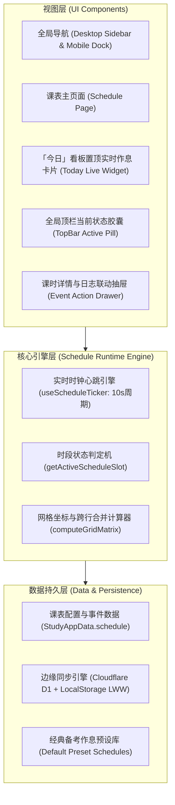
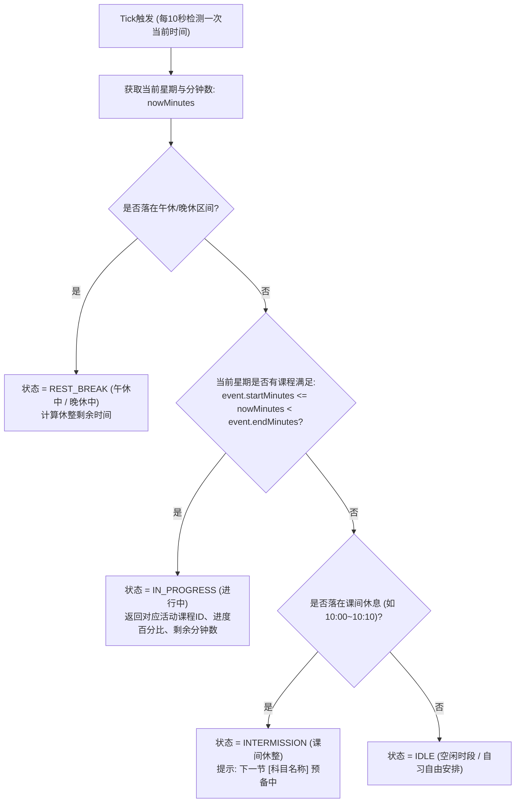

# 考研复习课表（课程表）与实时「进行中」状态功能详实设计方案

> **文件标识**：`docs/TIMETABLE_FEATURE_DESIGN.md`  
> **版本**：v1.0.0  
> **状态**：设计完成 (Ready for Review)  
> **关联系统**：408 考研备考空间 (Study Dashboard 2.0 / 408 Atlas)  
> **面向对象**：全栈开发、前端架构、UI/UX 交互设计

---

## 1. 项目背景与需求规格定义

### 1.1 需求背景与业务场景
在考研备考（尤其是针对计算机 408 统考、考研数学强化与真题冲刺、考研英语/政治）过程中，考生需要严格执行高纪律性、高强度的周期性作息计划。  
目前系统的「学习进度」模块侧重于**知识大纲的三层推进（书目→章节→小节）**，「今日」模块侧重于**单日任务的勾选打卡与复盘日志**。考生缺乏一个**宏观时间节律与即时时间感知相结合的作息时间视图**（即大学课程表/考研作息时间表）。

本功能的核心诉求：
1. **把高清晰度周视图复习作息课表（类手机课程表体验）无缝整合进现有的 408 Atlas 网站**。
2. **具备实时「进行中」（如截图中的「上课中」）状态动态判定与高亮视觉呈现**，无论考生在何时打开网页，都能立即看清：
   - 当前此时此刻正在进行什么科目复习；
   - 距离本节结束还有多少时间；
   - 本节所属的宏观排期与前后科目承接。
3. **支持灵活的科目跨节合并、休息时段分隔（午休、晚休）以及与现有日志、打卡系统的高效联动**。

---

### 1.2 原型截图深度特征反编译 (Reverse Engineering Analysis)

根据提供的两张高保真手机课程表运行截图，我们对界面元素与数据特征进行逐像素与数据层面的拆解：

```
┌──────────────────────────────────────────────────────────┐
│  ← 课程表                     [分屏/宫格视图切换]  [⋮ 菜单] │
├──────────────────────────────────────────────────────────┤
│  [2周 ▾]  周一   周二   周三   【周四】  周五   周六   周日 │
│           8/31   9/1    9/2    【9/3】   9/4    9/5    9/6   │
├─────┬────────────────────────────────────────────────────┤
│  1  │ (空闲自习)                                         │
│08:10│                                                    │
├─────┼─────────────────────────────────────────────┬──────┤
│ 2~4 │  数 学 强 化 (周一 ~ 周五 连续合并大块)      │(空闲)│
│09:10│  [浅蓝底色 #EFF6FF / 钴蓝字体 #2563EB]      │      │
│12:00│                                             │      │
├─────┴─────────────────────────────────────────────┴──────┤
│ ═══════════════════════  午休 (12:00 - 14:00) ══════════ │
├─────┬─────────────────────────────────────────────┬──────┤
│ 5~8 │  4 0 8 (周一 ~ 周六 连续 4 节贯通大块)      │(休息)│
│14:00│  [浅紫底色 #F5F3FF / 丁香紫字体 #7C3AED]    │      │
│18:00│                                             │      │
├─────┴─────────────────────────────────────────────┴──────┤
│ ═══════════════════════  晚休 (18:00 - 18:30) ══════════ │
├─────┬────────────────────────────────────────────────────┤
│  9  │ (空闲自习 / 缓冲)                                  │
├─────┼──────┬──────┬──────┬──────┬──────┬──────────┬──────┤
│10~11│ 408  │ 数学 │ 408  │ 数学 │ 408  │ 数学强化 │(空闲)│
│19:30│(紫色)│(绿色)│(紫色)│【上课│(紫色)│ (蓝色)   │      │
│21:20│      │      │      │ 中】 │      │          │      │
├─────┼──────┴──────┴──────┴──────┴──────┴──────────┼──────┤
│ 12  │ (自习/缓冲)                                 │ 英政 │
├─────┼─────────────────────────────────────────────┤(珊瑚 │
│ 13  │  英 政 (周一 ~ 周六 单节高效回顾)           │ 赤红)│
│22:30│  [浅粉底色 #FEF2F2 / 暖赤红字体 #9C413B]    │      │
└─────┴─────────────────────────────────────────────┴──────┘
```

#### 关键特征梳理表：
| 维度 | 原型表现 | 业务涵义 |
| :--- | :--- | :--- |
| **周期粒度** | 7 天周视图（周一至周日） | 标准考研备考周循环，支持周次切换（如 `第 2 周 ▾`） |
| **日期标注** | 星期 + 自然月日（如 `周四 9/3`） | 顶部吸顶显示，**当前所在日（9/3）使用主色高亮与加粗标注** |
| **节次规划** | 共 13 节课（每节标准 50 分钟） | 严谨的时间标尺，左侧清晰显示节号及精准起止时间 `08:10-09:00` 等 |
| **大段休整** | 「午休」与「晚休」全宽横穿分割条 | 午休（12:00~14:00）与晚休（18:00~18:30/19:30），切分早/中/晚三大战役 |
| **连续合并** | 多节次连续跨行单元格合并（Rowspan） | 上午数学强化（2~4节，跨3节）、下午408（5~8节，跨4节）、晚间自习（10~11节，跨2节） |
| **色彩语意** | 分科独占色块与弱化背景 | **408**（紫）、**数学强化**（蓝）、**基础数学**（绿）、**英政**（珊瑚赤） |
| **实时状态** | **[上课中] / [进行中] 胶囊标牌** | 当当前系统时间落在 `周四 19:30~21:20` 时，该卡片原地显示醒目徽章与状态动效 |

---

## 2. 系统整体架构与模块集成规划

### 2.1 架构分层设计



### 2.2 站点各处的多维触达规划
复习课表不仅是一个独立的展示看板，更应作为整个备考系统的**时空罗盘**深度渗透：

1. **独立顶级页面 `AppPage = "schedule"`（作息课表）**：
   - 桌面端左侧导航栏（`pageNavigation`）：新增 `作息课表` 入口，纯 CSS 几何图标（日历时钟栅格符号）。
   - 移动端底部 Dock 栏（`mobileNavigation`）：5 格布局优化，符号 `表` / `课`，标签 `课表`。
   - 提供全屏沉浸式周视图、日视图切换、当前周选择器、导出为长图/打印等功能。
2. **「今日 (Today)」执行看板头部置顶卡片**：
   - 考生每天最常驻留的页面是「今日」。在今日任务看板的最上方，新增 **【当前作息】实况卡**：
     - 若当前在上课：显示 `🟢 进行中：408 专业课强化 (14:00 - 18:00) · 剩余 45 分钟`，右侧配备一键「记当前小结」与「专注计时」；
     - 若当前在课间/午休：显示 `☕ 休息中：午休蓄能 (至 14:00 结束) · 下一节：408 计算机组成原理`；
     - 若今日课程已全结束：显示 `🌙 今日作息已圆满完成 · 累计高效时长 8.5 小时`。
3. **顶部导航栏 (Topbar) 的实时态微缩胶囊**：
   - 在顶栏右侧展示轻量脉冲徽标，如 `[19:30 数学强化 · 剩32分]`，点击平滑滚回或跳转至课表对应高亮单元格。

---

## 3. UI/UX 视觉体系与高保真原型规范

### 3.1 视觉设计理念与色彩规范

为与 408 Atlas 现有的**学术人文纸质美学**（暖米纸色 `--paper: #fbfaf6`、深青墨黑 `--sidebar: #111b24`、珊瑚朱红 `--coral: #ef846d`、衬线宋体标题）完美契合，课表色彩在保留截图识别度的同时，进行了符合现代 Web 标准的高对比度、柔和化调优：

#### 科目视觉主题矩阵 (Subject Color Themes)
| 科目标识 | 主题色名称 | 文本/前景色 (Foreground) | 卡片浅色背景 (Background) | 边框描边 (Border) | 适用场景 |
| :--- | :--- | :--- | :--- | :--- | :--- |
| `cs408` | 经典皇室紫 | `#6d28d9` (Violet 700) | `#f5f3ff` (Violet 50) | `#ddd6fe` (Violet 200) | 408 四门统考核心大块复习 |
| `math_intense`| 专注深钴蓝 | `#1d4ed8` (Blue 700) | `#eff6ff` (Blue 50) | `#bfdbfe` (Blue 200) | 数学强化刷题、重难点攻坚 |
| `math_regular`| 清爽竹林绿 | `#15803d` (Green 700) | `#f0fdf4` (Green 50) | `#bbf7d0` (Green 200) | 数学基础回顾、公式记忆、日常小练 |
| `english_pol`| 珊瑚茶赤红 | `#b91c1c` (Red 700) | `#fef2f2` (Red 50) | `#fecaca` (Red 200) | 英语阅读/真题、政治知识点默写背诵 |
| `custom` | 暖沉香琥珀 | `#b45309` (Amber 700) | `#fffbeb` (Amber 50) | `#fde68a` (Amber 200) | 自定义模块、院校专业课加试等 |
| `break_rest` | 雅灰中性色 | `#475569` (Slate 600) | `#f1f5f9` (Slate 100) | `#e2e8f0` (Slate 200) | 午休、晚休、课间全宽横条 |

> **无障碍与暗色适配说明**：
> - 文本色与背景色在 WCAG 2.1 标准下的对比度均高于 4.5:1（符合 AA 级可访问性要求）。
> - 边框采用同色系 200 色阶，即便在低色域显示器或阳光直射手机屏幕上也有清晰的块面轮廓。

---

### 3.2 网格排版系统 (Grid Architecture)

采用标准的 CSS Grid 结构搭建课表主框架，避免复杂的绝对定位偏移：

```css
/* 课表核心容器 */
.schedule-grid {
  display: grid;
  /* 左侧时间轴宽度固定为 68px，后接 7 列等宽星期列 */
  grid-template-columns: 68px repeat(7, minmax(0, 1fr));
  /* 
    行划分：
    - 行 1: 顶部日期表头 (52px)
    - 行 2~5: 上午第 1~4 节 (每节最小 64px)
    - 行 6: 午休横跨栏 (32px)
    - 行 7~10: 下午第 5~8 节 (每节最小 64px)
    - 行 11: 晚休横跨栏 (32px)
    - 行 12~16: 晚间第 9~13 节 (每节最小 64px)
  */
  grid-template-rows: 52px repeat(4, minmax(64px, 1fr)) 32px repeat(4, minmax(64px, 1fr)) 32px repeat(5, minmax(64px, 1fr));
  gap: 4px;
  background-color: var(--canvas, #f2efe7);
  padding: 12px;
  border-radius: 16px;
  user-select: none;
}
```

#### 跨行大卡片 (Merged Cards) 的定位原理：
以「周一 2~4 节 数学强化」为例：
- 列坐标：`grid-column: 2 / span 1;`（周一对应第 2 列，因第 1 列是时间标尺）
- 行坐标：`grid-row: 3 / span 3;`（第 1 行是表头，第 2 行是第 1 节，第 2~4 节对应行序号 3、4、5，故 `grid-row: 3 / span 3`）
- 午休横条：`grid-column: 1 / -1; grid-row: 6;`（全宽横贯，文字居中）

---

### 3.3 移动端与桌面端双端适配设计

| 设备断点 | 布局策略 | 交互设计细节 |
| :--- | :--- | :--- |
| **桌面宽屏 (Desktop ≥ 1024px)** | 完整 7 列排开，右侧可呼出「本周复盘 & 科目用时分布图」分屏 | 悬停卡片上浮放大（`translateY(-2px)`），显示该科今日已学时长，支持点击原地弹出微型操作菜单 |
| **平板中屏 (Tablet 768px ~ 1023px)** | 7 列紧凑显示，字体尺寸自适应缩微（`clamp()`） | 左侧时间轴仅显示简写（`1节`、`2节`），点击表头可展开当日详细作息清单 |
| **手机竖屏 (Mobile < 768px)** | **1:1 还原原型截图体验**：顶部吸顶周次与日期栏，主表格纵向平滑滚动 | 1. 顶部日期吸顶（`position: sticky; top: 0; z-index: 20`）；<br>2. 今日列增加柔和纵向阴影光柱或高亮边框；<br>3. 支持左右手势滑动切换「上一周 / 下一周」；<br>4. 自动平滑居中滚动到「当前正在进行」的节次行，无需用户每次手动下滑寻找。 |

---

## 4. 核心引擎设计：实时「进行中」计算与状态机

### 4.1 精确时间判决算法 (Time Resolution Engine)

系统需建立一套高容错、低功耗的时间计算管道。

#### 标准作息时刻表映射字典 (Time Slots Preset):
```typescript
export interface SchedulePeriod {
  periodNumber: number;  // 1 ~ 13
  name: string;          // "第 1 节"
  startTime: string;     // "08:10"
  endTime: string;       // "09:00"
  startMinutes: number;  // 8 * 60 + 10 = 490
  endMinutes: number;    // 9 * 60 + 0 = 540
  segment: "morning" | "afternoon" | "evening";
}

export interface RestBreak {
  id: "lunch" | "dinner";
  label: "午休" | "晚休";
  startTime: string;     // "12:00" / "18:00"
  endTime: string;       // "14:00" / "18:30"
  startMinutes: number;
  endMinutes: number;
}
```

#### 实时状态机判定流程图：



### 4.2 「进行中」微交互与视觉动效规格

截图中的 `【上课中】` 徽标是整个界面的灵魂指示器。规格定义如下：

```css
/* 「进行中」状态卡片高亮容器 */
.schedule-card--active {
  position: relative;
  z-index: 5;
  border-color: #2563eb !important;
  box-shadow: 0 0 0 2px #2563eb, 0 8px 20px rgba(37, 99, 235, 0.22);
  transform: scale(1.015);
  transition: transform 0.2s cubic-bezier(0.34, 1.56, 0.64, 1), box-shadow 0.2s ease;
}

/* 呼吸微光背景 */
.schedule-card--active::after {
  content: "";
  position: absolute;
  inset: -1px;
  border-radius: inherit;
  box-shadow: 0 0 12px rgba(37, 99, 235, 0.45);
  animation: pulse-glow 2.4s ease-in-out infinite alternate;
  pointer-events: none;
}

@keyframes pulse-glow {
  0% { opacity: 0.35; transform: scale(1); }
  100% { opacity: 0.85; transform: scale(1.02); }
}

/* 截图同款【上课中 / 进行中】胶囊标牌 */
.badge-in-progress {
  display: inline-flex;
  align-items: center;
  gap: 4px;
  margin-top: 6px;
  padding: 3px 8px;
  border-radius: 9999px;
  background-color: #2563eb;
  color: #ffffff;
  font-size: 11px;
  font-weight: 600;
  letter-spacing: 0.04em;
  box-shadow: 0 2px 6px rgba(37, 99, 235, 0.35);
}

.badge-in-progress__dot {
  width: 5px;
  height: 5px;
  border-radius: 50%;
  background-color: #ffffff;
  animation: blink 1.2s ease-in-out infinite;
}

@keyframes blink {
  0%, 100% { opacity: 1; }
  50% { opacity: 0.3; }
}
```

### 4.3 性能与能耗优化（Web 页面长效常驻）
很多考生会将备考看板在 iPad 或第二显示器上全天常驻显示，因此必须避免传统的单盲轮询消耗 CPU 与电池：
1. **基于 Page Visibility API 的智能节流**：
   - 页面处于前台（`document.visibilityState === "visible"`）：以 10 秒为周期执行一次时间比对；
   - 页面切入后台或最小化：休眠定时器，重新唤醒时立即强制执行一次校准刷新；
2. **精确对齐系统整分触发**：
   - 在首次挂载时，计算距离下一分钟 `00 秒` 的差值毫秒数，首个周期对齐整分，后续每个整分执行校准，杜绝秒级时差漂移。

---

## 5. 数据模型与存储同步设计

### 5.1 数据模型设计 (TypeScript Data Schema)

在 `app/study-data.ts` 中无缝扩展 `StudyAppData`，增加 `schedule` 字段，保持向下兼容性：

```typescript
/**
 * 课表星期枚举 (1: 周一 ~ 7: 周日)
 */
export type WeekdayNumber = 1 | 2 | 3 | 4 | 5 | 6 | 7;

/**
 * 课表科目视觉主题
 */
export type ScheduleThemeKey = "cs408" | "math_intense" | "math_regular" | "english_pol" | "custom";

/**
 * 单条课程/复习排程项
 */
export interface ScheduleEvent {
  id: string;                      // 唯一UUID，如 "evt_mon_math_intense"
  title: string;                   // 显示名称，如 "数学强化"、"408"、"英政"
  theme: ScheduleThemeKey;         // 视觉主题色
  dayOfWeek: WeekdayNumber;        // 1 ~ 7
  startPeriod: number;             // 起始节次 1 ~ 13
  endPeriod: number;               // 结束节次 1 ~ 13 (若单节则与 startPeriod 相同)
  locationOrNotes?: string;        // 备注信息 (如 "自习室B区"、"李林8套卷模考")
  linkedArea?: "408" | "math" | "english" | "politics"; // 关联备考科目，打通知识大纲
  applicableWeeks?: number[];      // 适用周次 (留空表示每周固定，[1,3,5] 表示奇数周)
}

/**
 * 节次时间配置项 (支持考生根据实际学校作息定制)
 */
export interface CustomPeriodConfig {
  period: number;                  // 1 ~ 13
  start: string;                   // "08:10"
  end: string;                     // "09:00"
}

/**
 * 整个课表系统的完整持久化状态
 */
export interface ScheduleAppData {
  version: 1;                      // 课表数据版本号
  activeWeek: number;              // 当前选中的查看周次 (默认第 2 周)
  semesterStartDate: string;       // 学期/备考开营起始基准日期 (YYYY-MM-DD)，如 "2026-08-24"
  periods: CustomPeriodConfig[];   // 13节课时间配置 (默认提供截图规范 08:10~23:20)
  lunchBreak: { start: string; end: string };   // 默认 12:00 ~ 14:00
  dinnerBreak: { start: string; end: string };  // 默认 18:00 ~ 18:30
  events: ScheduleEvent[];         // 所有排课条目
}
```

### 5.2 默认内置考研作息预设（严格还原用户截图）

系统初始加载时直接提供原汁原味的默认课表数据，开箱即用：

```typescript
export const DEFAULT_SCHEDULE_EVENTS: ScheduleEvent[] = [
  // ── 上午：周一至周五 2~4 节 (09:10 - 12:00) 数学强化 ──
  { id: "e_mon_math", title: "数学强化", theme: "math_intense", dayOfWeek: 1, startPeriod: 2, endPeriod: 4, linkedArea: "math" },
  { id: "e_tue_math", title: "数学强化", theme: "math_intense", dayOfWeek: 2, startPeriod: 2, endPeriod: 4, linkedArea: "math" },
  { id: "e_wed_math", title: "数学强化", theme: "math_intense", dayOfWeek: 3, startPeriod: 2, endPeriod: 4, linkedArea: "math" },
  { id: "e_thu_math", title: "数学强化", theme: "math_intense", dayOfWeek: 4, startPeriod: 2, endPeriod: 4, linkedArea: "math" },
  { id: "e_fri_math", title: "数学强化", theme: "math_intense", dayOfWeek: 5, startPeriod: 2, endPeriod: 4, linkedArea: "math" },

  // ── 下午：周一至周六 5~8 节 (14:00 - 18:00) 408 统考 ──
  { id: "e_mon_408", title: "408", theme: "cs408", dayOfWeek: 1, startPeriod: 5, endPeriod: 8, linkedArea: "408" },
  { id: "e_tue_408", title: "408", theme: "cs408", dayOfWeek: 2, startPeriod: 5, endPeriod: 8, linkedArea: "408" },
  { id: "e_wed_408", title: "408", theme: "cs408", dayOfWeek: 3, startPeriod: 5, endPeriod: 8, linkedArea: "408" },
  { id: "e_thu_408", title: "408", theme: "cs408", dayOfWeek: 4, startPeriod: 5, endPeriod: 8, linkedArea: "408" },
  { id: "e_fri_408", title: "408", theme: "cs408", dayOfWeek: 5, startPeriod: 5, endPeriod: 8, linkedArea: "408" },
  { id: "e_sat_408", title: "408", theme: "cs408", dayOfWeek: 6, startPeriod: 5, endPeriod: 8, linkedArea: "408" },

  // ── 晚间前半场：10~11 节 (19:30 - 21:20) 交替穿插 ──
  { id: "e_mon_eve_408", title: "408", theme: "cs408", dayOfWeek: 1, startPeriod: 10, endPeriod: 11, linkedArea: "408" },
  { id: "e_tue_eve_math", title: "数学", theme: "math_regular", dayOfWeek: 2, startPeriod: 10, endPeriod: 11, linkedArea: "math" },
  { id: "e_wed_eve_408", title: "408", theme: "cs408", dayOfWeek: 3, startPeriod: 10, endPeriod: 11, linkedArea: "408" },
  { id: "e_thu_eve_math", title: "数学", theme: "math_regular", dayOfWeek: 4, startPeriod: 10, endPeriod: 11, linkedArea: "math" },
  { id: "e_fri_eve_408", title: "408", theme: "cs408", dayOfWeek: 5, startPeriod: 10, endPeriod: 11, linkedArea: "408" },
  { id: "e_sat_eve_math", title: "数学强化", theme: "math_intense", dayOfWeek: 6, startPeriod: 10, endPeriod: 11, linkedArea: "math" },

  // ── 晚间后半场：13 节 (22:30 - 23:20) / 周日 12~13 节 (21:30 - 23:20) 英政 ──
  { id: "e_mon_night_ep", title: "英政", theme: "english_pol", dayOfWeek: 1, startPeriod: 13, endPeriod: 13 },
  { id: "e_tue_night_ep", title: "英政", theme: "english_pol", dayOfWeek: 2, startPeriod: 13, endPeriod: 13 },
  { id: "e_wed_night_ep", title: "英政", theme: "english_pol", dayOfWeek: 3, startPeriod: 13, endPeriod: 13 },
  { id: "e_thu_night_ep", title: "英政", theme: "english_pol", dayOfWeek: 4, startPeriod: 13, endPeriod: 13 },
  { id: "e_fri_night_ep", title: "英政", theme: "english_pol", dayOfWeek: 5, startPeriod: 13, endPeriod: 13 },
  { id: "e_sat_night_ep", title: "英政", theme: "english_pol", dayOfWeek: 6, startPeriod: 13, endPeriod: 13 },
  { id: "e_sun_night_ep", title: "英政", theme: "english_pol", dayOfWeek: 7, startPeriod: 12, endPeriod: 13 },
];
```

### 5.3 边缘存储与无损同步 (Cloudflare D1 + LocalStorage)
与 408 Atlas 的整体同步策略一致：
1. **本地瞬时响应**：修改课表无需等待网络请求，直接写入 LocalStorage 并更新 React State，零交互延迟；
2. **边缘防抖入库**：在后台 350ms 防抖同步至 Cloudflare D1 边缘数据库中的 `user_workspaces` 表；
3. **备份与灾备恢复**：纳入系统现有的「导入/导出」与「版本备份快照（LocalBackup）」中，误删课表支持一键回退。

---

## 6. 交互流程与业务联动设计

### 6.1 课表课时点击联动 (Event Interaction Drawer)

当考生在课表上点击任意一个卡片（如周四晚间「数学」或下午「408」），从屏幕右侧滑出轻量抽屉面板：

```
┌──────────────────────────────────────────────┐
│  数学 (强化复习)                     [✕ 关闭] │
│  周四 · 第 10~11 节 (19:30 - 21:20)          │
│  状态：【🟢 正在进行中 · 剩余 37 分钟】      │
├──────────────────────────────────────────────┤
│  ⚡ 快速行动                                 │
│  [✍ 记录本时段复习心得]                      │
│     → 点击直接调起 Markdown 日志编辑器，     │
│       自动预填时间标签与科目分类             │
│                                              │
│  [📋 关联今日待学小节]                       │
│     → 快速呼出今日未完成小节（如高等数学     │
│       中值定理），支持一键标记「学完」       │
│                                              │
│  [⏱ 沉浸式番茄钟模式 (Focus Mode)]           │
│     → 全屏倒计时，屏蔽干扰信息               │
├──────────────────────────────────────────────┤
│  ⚙️ 调整排课                                  │
│  [修改节次]  [更换科目]  [清空本科排期]      │
└──────────────────────────────────────────────┘
```

### 6.2 课表自定义配置能力 (Customization Mode)
1. **灵活编辑**：支持进入「编辑模式」，点击空白单元格直接新建排程，拖拽或调整上下滑块快速调整起止节次；
2. **作息时间微调**：针对不同大学或自习室开闭馆时间，考生可在「设置」中微调每节课的分钟区间（如将早课从 08:10 改为 08:30）；
3. **预设一键重置**：提供「恢复考研标准默认作息」按钮，随时找回经典课表。

---

## 7. 实施路线与工程落地规划 (Roadmap)

本方案设计严密，建议分三个清晰阶段推进落地：

### 第一阶段 (Phase 1)：课表核心组件与实时引擎构建
- [x] 完成架构设计文档与接口定义 (`TIMETABLE_FEATURE_DESIGN.md`);
- [ ] 创建 `app/components/schedule/` 核心目录及组件群：
  - `TimetableGrid.tsx` (主栅格渲染器，支持多节合并卡片)
  - `ScheduleHeader.tsx` (周次选择与日期表头，高亮今天)
  - `TimeRuler.tsx` (左侧 13 节次与午晚休标尺)
  - `useScheduleTicker.ts` (实时判定「进行中」状态的心跳 Hook)
- [ ] 挂载到主页面导航，实现完整的周视图预览与「上课中」呼吸动态高亮。

### 第二阶段 (Phase 2)：双端深度适配与「今日」看板置顶联动
- [ ] 适配手机端竖屏吸顶与平滑居中滚动至当前节次；
- [ ] 在「今日 (Today)」工作台首屏注入 `TodayScheduleBanner` 实时微模块；
- [ ] 顶部导航栏集成全局实时状态徽标。

### 第三阶段 (Phase 3)：互动抽屉、数据持久化与编辑管理
- [ ] 点击卡片滑出「联动抽屉」（记日志、打卡、计时）；
- [ ] 完善 LocalStorage + D1 增量同步与导入/导出能力；
- [ ] 提供图形化编辑排课与重置默认课表功能。

---

## 8. 总结与设计结论

通过本设计方案，408 Atlas 将从原本**静态的宏观进度树与单日清单**，跃升为**兼具「宏观作息节奏律动」与「微观精准时间把控」的全天候沉浸式考研工作台**。  
严格还原用户截图中的审美细节与业务逻辑，用优雅的原生 CSS 架构和轻量低功耗的计算引擎，为考生提供最安心、最专注的备考体验。
